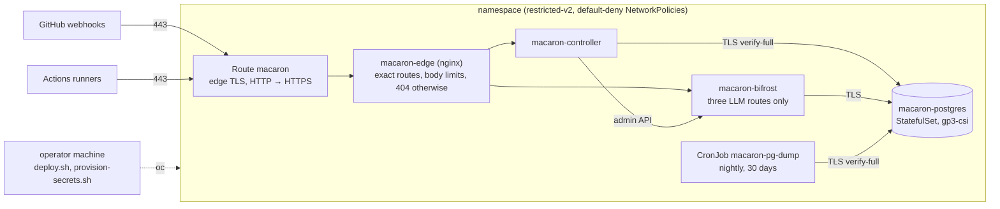

# macaron-bot on OpenShift

The VPS deployment ([DEPLOYMENT.md](DEPLOYMENT.md)) moves to an OpenShift namespace (issue #24). The supply chain is unchanged: images pinned by digest, verified before pinning. The trust model is unchanged too: GitHub holds no credential to the cluster, and an operator applies a clean checkout of `main` from their machine.



## Layout (`deploy/openshift/`)

| File | What |
|---|---|
| `kustomization.yaml` | The resources, and ConfigMaps generated from `postgres/`, `edge/` and `deploy/bifrost/`. A content hash in each name rolls the pods when a file changes. No namespace: the scripts take it from `MACARON_NAMESPACE` |
| `postgres.yaml` | Red Hat's `rhel10/postgresql-18` as a single-replica StatefulSet (the cluster runs no Postgres operator) |
| `postgres/macaron.sh` | Start hook, run on every start: the `bifrost` role and database, `CONNECT` revoked from PUBLIC, `pg_hba` restricted to `hostssl … scram-sha-256` |
| `postgres/macaron.conf` | TLS with the Service's serving certificate (issued and rotated by OpenShift's service CA), logs to stderr |
| `backup.yaml` | Nightly `pg_dump` of both databases, each by its owner, to the `macaron-backups` volume, kept 30 days |
| `bifrost.yaml` | An initContainer renders `config.json` with `deploy/bifrost/render-config.sh` (upstream URL from the Secret, `PG_SSL_MODE=require`). `Recreate`: never two instances charging the same keys |
| `controller.yaml` | `config/` mounted from a ConfigMap that `deploy.sh` generates. `DATABASE_URL` is assembled from the Secret's password and verifies the service CA |
| `edge.yaml`, `edge/nginx.conf` | Route (edge TLS, 600 s timeout for streams, no sticky cookie) and nginx, which keeps `deploy/caddy/Caddyfile`'s contract. Caddy's image needs a file capability that `restricted-v2` refuses. Keep both files in sync until the VPS is gone |
| `networkpolicies.yaml` | Default deny. DNS for every pod. TCP 443 to non-private addresses for the controller and Bifrost only (no cluster service, node or metadata endpoint). Then one allow-list per workload |

Every pod runs under `restricted-v2`:
- non-root, with a random UID;
- read-only root filesystem, with `emptyDir` for the writable paths;
- `capabilities.drop: [ALL]`, `seccompProfile: RuntimeDefault`;
- no service account token, and one ServiceAccount per workload.

## Secrets and settings (`scripts/provision-secrets.sh`)

Secrets are never in git and never on a command line. The script reads `~/.config/macaron/dev.env` and pipes each value through process substitution into `oc create secret --dry-run`. It then applies the result server-side, so no `last-applied-configuration` annotation keeps a copy of the values. Each workload gets its own Secret, holding only what that workload reads:

| Secret | Keys |
|---|---|
| `macaron-postgres` | `macaron-password`, `bifrost-password` |
| `macaron-backup` | `macaron-password`, `bifrost-password` |
| `macaron-controller` | `database-password`, `gh-interact`, `gh-push`, `gh-org`, `webhook-hmac`, `bifrost-admin-password` |
| `macaron-bifrost` | `llm-upstream-url`, `llm-upstream-key`, `admin-password`, `db-password`, `encryption-key` |
| `macaron-postgres-tls` | Created by the service CA |

Some values are generated once and then kept:
- **Database passwords:** generated by the script.
- **Bifrost's admin password and encryption key:** copied from the VPS over ssh (stdin only), because the restored Bifrost rows are encrypted with that key. `GENERATE_BIFROST_KEYS=1` generates new ones instead.

The settings ConfigMap `macaron-settings` holds:
- `PUBLIC_URL`, taken from the Route's generated host, and `BIFROST_PUBLIC_URL` (`<PUBLIC_URL>/llm/anthropic`);
- `MACARON_ENABLED`, `MACARON_ALLOWED_USER_IDS` and `LOG_LEVEL`, which keep their values unless given in the environment. A fresh namespace starts disabled, with the VPS's allowlist;
- `RUNNER_REPO_ID` and `RUNNER_OWNER_ID`;
- `LLM_BACKEND=bifrost`.

Pods read Secrets and settings when they start: `oc rollout restart deployment/macaron-controller deployment/macaron-bifrost` after a change.

## Deploy (`scripts/deploy.sh`)

```sh
export MACARON_NAMESPACE=<namespace>
deploy/openshift/scripts/deploy.sh                 # first run: creates the Route, stops at the missing Secrets
deploy/openshift/scripts/provision-secrets.sh
deploy/openshift/scripts/deploy.sh
```

The script:
1. Refuses an unclean checkout, or a commit other than `origin/main` unless `MACARON_DEPLOY_UNMERGED=1`.
2. Generates the `config/` ConfigMap, whose items rebuild the directory tree, and checks that the controller image is pinned by digest.
3. Runs a `pg_dump` Job before applying.
4. Refuses to restart a changed Bifrost while runs are unsettled, because it writes spend to Postgres only every 10 s.
5. Applies server-side and waits for every rollout. A Deployment that doesn't become ready is rolled back.

Pinning a new controller digest changes `deploy/openshift/controller.yaml` as well as the quadlet.

## Operations

- **Logs:** `oc logs deployment/macaron-controller` (JSON).
- **psql as the superuser:** only over the pod's local socket, `oc exec -it statefulset/macaron-postgres -- psql -d macaron`. Network logins need TLS and are never superuser.
- **Kill switch:** `MACARON_ENABLED=false deploy/openshift/scripts/provision-secrets.sh`, then restart the controller.
- **Off-cluster copy of the database:** the `macaron-backups` volume is in the same cluster. Until an object store is available, pull a dump to the operator's machine: `oc exec statefulset/macaron-postgres -- pg_dump --format=custom -d macaron > macaron.dump` (the same for `bifrost`). Keep it encrypted at rest.
- **Restore:**
  1. Scale the controller and Bifrost to 0.
  2. `oc exec -i statefulset/macaron-postgres -- pg_restore --clean --if-exists --no-owner --role=macaron -d macaron < macaron.dump`, and the same with `bifrost`.
  3. Scale back up.

## Cutover from the VPS

1. On OpenShift, deploy with `MACARON_ENABLED=false` and check the edge contract through the Route.
2. On the VPS, `MACARON_ENABLED=false` (this revokes every open key). Wait until no run is unsettled.
3. Stream both databases from the VPS into the new Postgres. Nothing is written to the operator's disk, and the dump from 17 restores into 18:
   1. Stop the writers: `oc scale deployment/macaron-controller deployment/macaron-bifrost --replicas=0`.
   2. `macaron`: `ssh open-macaron-vps 'sudo podman exec macaron-postgres pg_dump -Fc -U macaron -d macaron' | oc exec -i statefulset/macaron-postgres -- pg_restore --clean --if-exists --no-owner --role=macaron -d macaron`
   3. `bifrost`: the same, with `-d bifrost` on the VPS side (`macaron` is the VPS's superuser) and `--role=bifrost -d bifrost` on the OpenShift side.
   4. Start them again with `--replicas=1`.
4. Point open-macaron/runner's webhook (event `workflow_run`, same secret) to `<PUBLIC_URL>/v1/webhook`: `gh api -X PATCH repos/open-macaron/runner/hooks/<id>/config -f url=…` changes the URL alone. A missed delivery is caught up by the reconcile job. Runs get `PUBLIC_URL` as their `controller-url`, which is also the OIDC audience the controller checks.
5. Enable on OpenShift: `MACARON_ENABLED=true provision-secrets.sh`, then restart the controller.
6. Run one test on a sandbox repository from `config/`: status comment, run, review or PR, and cost settlement.
7. Keep the VPS stopped but intact until the new deployment has proved itself. Rollback is the webhook URL back to the VPS, then `MACARON_ENABLED=true` there.
