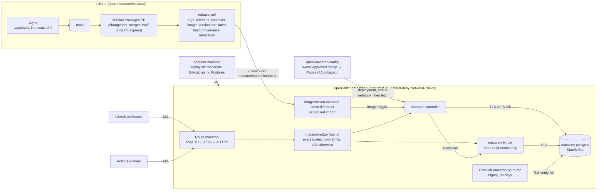

# macaron-bot — supply chain and deployment

Everything here is public: the repo, the images and the manifests. So no secret ever lives in git or in GitHub. Production runs in an OpenShift namespace. An operator applies a clean checkout of `main` from their machine with `oc`, and GitHub never gets a credential to the cluster.



Until 2026-10-21 production ran on a Fedora VPS with rootful Podman quadlets. It was migrated (#24): the databases were streamed over, the webhook was repointed, and the VPS was wiped and decommissioned. Its files are in git history before that date.

## 1. Image build (`release.yml`, `packages/controller/Containerfile`)

- **Two-stage Containerfile.** It builds on `registry.access.redhat.com/ubi10/nodejs-24` and runs on `ubi10/nodejs-24-minimal`, both pinned by digest.
- **What the build does:** `pnpm install --frozen-lockfile`, `pnpm build`, then `pnpm deploy --prod` into `/opt/app`. The runtime image only gets that folder and runs as a non-root user, which also works with OpenShift's random UIDs (group 0).
- **Release:** versions and changelogs are managed with [Changesets](https://changesets.dev) (.changeset/README.md). Merging the "Version Packages" PR that `release.yml` keeps up to date releases every package it bumps. changesets tags it (`@open-macaron/<package>@<version>`) and writes its GitHub release, then `release.yml` builds what was released:
  - **Controller:** buildah pushes `ghcr.io/open-macaron/controller:<version>`, `:sha-<commit>` and `:latest`.
  - **agent-cli, knowledge-cli and config-cli:** the bundles are attached to their release.
  - **`@open-macaron/review`:** published to npm.
  
  `actions/attest-build-provenance` attaches SLSA provenance to each artifact, signed by Sigstore through GitHub OIDC with no long-lived key.
- **Workflow permissions:** top level `permissions: {}`. Each release job gets only what it needs: `contents: write` and `pull-requests: write` to version and tag, `packages: write` for the image, `id-token: write` and `attestations: write` to attest (and to publish to npm).
- **Controller rollout:** production follows `ghcr.io/open-macaron/controller:latest` through the `macaron-controller` ImageStream (§2), so a controller release reaches the cluster without a pin or a deploy. The cluster doesn't verify the image's signature yet: OpenShift's `ImagePolicy` can't match a GitHub workflow's keyless signature (#35). Verify a digest by hand with `gh attestation verify oci://ghcr.io/open-macaron/controller@<digest> --signer-workflow open-macaron/macaron/.github/workflows/release.yml --source-ref refs/heads/main`.
- **Verification before pinning** (the CLI bundles, which downstream repositories pin by URL and sha256): `gh attestation verify <file> --signer-workflow open-macaron/macaron/.github/workflows/release.yml --source-ref refs/heads/main`.
- **Other images:** Bifrost (`docker.io/maximhq/bifrost`), Postgres (`registry.redhat.io/rhel10/postgresql-18`) and nginx (`registry.access.redhat.com/ubi10/nginx-126`) are pinned by digest in their manifests too.

## 2. Manifests (`deploy/openshift/`)

| File | What |
|---|---|
| `kustomization.yaml` | The resources, and ConfigMaps generated from `postgres/`, `edge/` and `deploy/bifrost/`. A content hash in each name rolls the pods when a file changes. No namespace: the scripts take it from `MACARON_NAMESPACE` |
| `postgres.yaml` | Red Hat's `rhel10/postgresql-18` as a single-replica StatefulSet on a `gp3-csi` volume. The cluster runs no Postgres operator: a test `PostgresCluster` was never reconciled |
| `postgres/macaron.sh` | Start hook, run on every start: the `bifrost` role and database, `CONNECT` revoked from PUBLIC, `pg_hba` restricted to `hostssl … scram-sha-256` |
| `postgres/macaron.conf` | TLS with the Service's serving certificate (issued and rotated by OpenShift's service CA), logs to stderr |
| `backup.yaml` | Nightly `pg_dump` of both databases, each by its owner, to the `macaron-backups` volume, kept 30 days |
| `bifrost.yaml` | An initContainer renders `config.json` with `deploy/bifrost/render-config.sh` (upstream URL from the Secret, `PG_SSL_MODE=require`). `Recreate`: never two instances charging the same keys |
| `controller-imagestream.yaml` | `macaron-controller:latest`, following `ghcr.io/open-macaron/controller:latest` with a scheduled import (the cluster's interval, about 15 minutes), pulled from ghcr.io by digest. The controller Deployment's `image.openshift.io/triggers` annotation rolls it out on each new digest |
| `controller.yaml` | Configuration from open-macaron/config's published snapshot (`CONFIG_URL`, §6). `DATABASE_URL` is assembled from the Secret's password and verifies the service CA. `RollingUpdate`: migrations run under an advisory lock and pg-boss coordinates through Postgres |
| `edge.yaml`, `edge/nginx.conf` | The Route (edge TLS, 600 s timeout for LLM streams, no sticky cookie) and nginx, which holds the routing contract of DESIGN.md §7. The official Caddy image can't be used under `restricted-v2`: its binary carries a file capability |
| `networkpolicies.yaml` | Default deny, DNS for every pod, then one allow-list per workload |

The edge exposes `/v1/bootstrap` and `/v1/webhook`, plus `POST …/messages`, `POST …/messages/count_tokens` and `GET …/models` under `/llm/anthropic/v1`. It forwards each to its canonical upstream path: `location =` matches exactly, case-sensitively, on the normalised path. Everything else gets a 404, Bifrost's admin API and UI included. Body limits are 26 MB (controller) and 32 MB (LLM routes).

### Security

- **Pods:** every pod runs under the `restricted-v2` SCC:
  - non-root, with a random UID;
  - read-only root filesystem, with `emptyDir` for the writable paths;
  - `capabilities.drop: [ALL]`, `seccompProfile: RuntimeDefault`;
  - no service account token, and one ServiceAccount per workload.
- **Network:**
  - Postgres is reached only by the controller, Bifrost and the backup job.
  - Bifrost is reached only by the edge and the controller, and the controller only by the edge.
  - Only the controller and Bifrost reach the internet: TCP 443 to non-private addresses. No cluster service, node or cloud metadata endpoint is reachable.
- **Database:**
  - network logins need TLS and scram, and are never the superuser;
  - the superuser is only reachable through the pod's local socket (`oc exec`), which needs the namespace's admin rights;
  - each role can open only its own database.

## 3. Local stack (`deploy/bifrost/dev.sh`)

`deploy/bifrost/dev.sh up` runs Bifrost and its Postgres, configured like production, rootless on one Podman network. Production's edge (`edge/nginx.conf`) sits in front, behind a local TLS terminator that stands in for the router. Images are read from the manifests, except Postgres: production's image needs a Red Hat login, so it uses the public CentOS Stream build of the same image. It serves `pnpm test:live` and manual checks, with `BIFROST_ADMIN_URL=http://127.0.0.1:18080` and `BIFROST_PUBLIC_URL=https://localhost:18443/llm/anthropic` in `dev.env`.

## 4. Secrets and settings (`scripts/provision-secrets.sh`, never in git)

Secrets are never in git and never on a command line. The script reads `~/.config/macaron/dev.env` and pipes each value through process substitution into `oc create secret --dry-run`. It then applies the result server-side, so no `last-applied-configuration` annotation keeps a copy of the values. Each workload gets its own Secret, holding only what that workload reads:

| Secret | Keys |
|---|---|
| `macaron-postgres` | `macaron-password`, `bifrost-password` |
| `macaron-backup` | `macaron-password`, `bifrost-password` |
| `macaron-controller` | `database-password`, `gh-interact`, `gh-push`, `gh-org`, `webhook-hmac`, `bifrost-admin-password` |
| `macaron-bifrost` | `llm-upstream-url`, `llm-upstream-key`, `admin-password`, `db-password`, `encryption-key` |
| `macaron-postgres-tls` | Created by the service CA |

| Value | Content | Rotation |
|---|---|---|
| `gh-interact`, `gh-push`, `gh-org` | PATs of macaron-bot, scopes in REPOSITORIES.md §3 | ≤ 90 days |
| `llm-upstream-url` | The upstream's Anthropic-compatible URL, kept out of the public repository | When it moves |
| `llm-upstream-key` | The upstream LLM key | As the company requires |
| `webhook-hmac` | Shared with `open-macaron/runner`'s `workflow_run` webhook (and any upstream admin who installs our webhook) | Yearly |
| Database passwords, Bifrost's admin password | Generated by the script on a fresh namespace, then kept | On demand |
| `encryption-key` | Encrypts the keys Bifrost stores. Generated once | **Never**: Bifrost can't change it without wiping its database. Keep a copy outside the cluster (the maintainers' password manager), or a lost namespace makes the `bifrost` dumps unreadable |

The OpenRouter keys (`OPENROUTER_PROVISIONING_KEY`, `OPENROUTER_ROUTER_KEY`) aren't provisioned while `LLM_BACKEND=bifrost`: they are disabled.

The settings ConfigMap `macaron-settings` holds:
- `PUBLIC_URL`, taken from the Route's generated host, and `BIFROST_PUBLIC_URL` (`<PUBLIC_URL>/llm/anthropic`);
- `MACARON_ENABLED`, `MACARON_ALLOWED_USER_IDS` and `LOG_LEVEL`, which keep their values unless given in the environment. A fresh namespace starts disabled, and refuses to start without `MACARON_ALLOWED_USER_IDS` given (empty means no restriction);
- `RUNNER_REPO_ID` and `RUNNER_OWNER_ID`;
- `CONFIG_URL` and `CONFIG_REPO_ID`: open-macaron/config's published snapshot (§6, "Configuration"). They default to `https://open-macaron.github.io/config/v1` and that repository's id, `1429850279`, and `deploy.sh` refuses to deploy without them;
- `LLM_BACKEND=bifrost`.

Pods read Secrets and settings when they start: `oc rollout restart deployment/macaron-controller deployment/macaron-bifrost` after a change.

## 5. Deploy (`scripts/deploy.sh`)

```sh
export MACARON_NAMESPACE=<namespace>
deploy/openshift/scripts/deploy.sh                 # fresh namespace: creates the Route, stops at the missing Secrets
MACARON_ALLOWED_USER_IDS=<ids> deploy/openshift/scripts/provision-secrets.sh
deploy/openshift/scripts/deploy.sh
```

The script:
1. Refuses an unclean checkout, or a commit other than `origin/main` unless `MACARON_DEPLOY_UNMERGED=1`.
2. Checks that `macaron-settings` has `CONFIG_URL`, and sets the controller image to the digest the ImageStream holds (importing it on a first deploy), so a deploy never moves the controller.
3. Runs a `pg_dump` Job before applying.
4. Refuses to restart a changed Bifrost while runs are unsettled, because Bifrost writes spend to Postgres only every 10 s.
5. Applies server-side and waits for every rollout. A Deployment that doesn't become ready is rolled back.

Neither a configuration change nor a controller release is a deploy: the controller reloads open-macaron/config's snapshot when Pages publishes it, and the ImageStream picks up a release.

## 6. Operations

- **Logs:** `oc logs deployment/macaron-controller` (JSON lines from pino, secrets redacted), `deployment/macaron-bifrost`, `deployment/macaron-edge`, `statefulset/macaron-postgres`.
- **Kill switch:** `MACARON_ENABLED=false deploy/openshift/scripts/provision-secrets.sh`, then restart the controller. The controller stops ingesting, refuses to launch runs and revokes open keys. `oc scale deployment/macaron-controller --replicas=0` is the hard stop: open keys still expire on their own, and the sweeper deletes them on the next start.
- **User allowlist:** `MACARON_ALLOWED_USER_IDS=<id>,<id>` limits who can trigger the bot to those numeric GitHub user ids, whatever open-macaron/config trusts. Ids rather than logins, because a login can be renamed and re-registered. Set it through `provision-secrets.sh`, then restart the controller.
- **LLM backend:** production uses Bifrost over the upstream LLM key (`LLM_BACKEND=bifrost`). Models must be priced in `deploy/bifrost/pricing.json`. The controller refuses to start when the active backend can't price a configured model, and refuses to mint keys for one after a config reload. A configured backend that isn't active and fails its start-up check is logged and left out.
- **Configuration:** the controller reads [open-macaron/config](https://github.com/open-macaron/config)'s snapshot (`<CONFIG_URL>/config.json`, schema `config-published`). A change is a PR there, approved by the project folder's owners, or merged by hand by the platform team for `global.yaml` and settings that decide who can trigger the bot or what it may spend (that repository's README). `CONFIG_DIR` is only for local runs and tests.
  - **When it changes:** a successful Pages deployment of `CONFIG_REPO_ID` sends `deployment_status` to `/v1/webhook`, and the controller reloads that commit, retrying until Pages serves it. The two-minute reconcile also revalidates the snapshot (a 304 when unchanged), in case a delivery is delayed or lost.
  - **What it accepts:** a snapshot replaces the live one only if it is valid and the active LLM backend prices every model it configures. Otherwise the controller logs `configuration … rejected` and keeps the live one.
  - **Boot:** the controller starts on the published snapshot. If Pages can't serve a valid one, it starts on the snapshot it applied last, which is stored in `config_snapshots`, also the record of which commit was live when. With neither, it refuses to start.
  - **Which commit is live:** `oc exec statefulset/macaron-postgres -- psql -d macaron -c 'select commit, applied_at from config_snapshots order by applied_at desc limit 5'`.
- **Controller version:** `oc get imagestreamtag macaron-controller:latest -o jsonpath='{.image.dockerImageMetadata.Config.Labels.org\.opencontainers\.image\.version}'`, and `oc describe imagestream macaron-controller` for the digests imported over time.
- **Rolling back the controller:** pin the tag to an earlier digest from that history, which also stops the scheduled import: `oc tag --scheduled=false ghcr.io/open-macaron/controller@sha256:<earlier> macaron-controller:latest`. The trigger rolls the Deployment to it. Following releases again means releasing a fixed version, then `deploy.sh` (it re-applies `scheduled: true`).
- **psql:** `oc exec -it statefulset/macaron-postgres -- psql -d macaron`, as the superuser over the local socket.
- **Off-cluster copy of the database:** the `macaron-backups` volume is in the same cluster. Until an object store is available, pull a dump to the operator's machine: `oc exec statefulset/macaron-postgres -- pg_dump --format=custom -d macaron > macaron.dump`, and the same for `bifrost`. Keep the dumps encrypted at rest.
- **Restore** (the procedure used for the migration):
  1. Stop the writers: `oc scale deployment/macaron-controller deployment/macaron-bifrost --replicas=0`.
  2. Recreate the databases empty, as the superuser: `DROP DATABASE … WITH (FORCE)`, `CREATE DATABASE macaron OWNER macaron`, the same for `bifrost`, then `REVOKE CONNECT … FROM PUBLIC` on both.
  3. `oc exec -i statefulset/macaron-postgres -- pg_restore --no-owner --role=macaron --exit-on-error -d macaron < macaron.dump`, and the same with `--role=bifrost -d bifrost`.
  4. Compare the row counts with the source, then scale the writers back to 1.
- **Moving `PUBLIC_URL`** (a new Route host or namespace):
  1. Run `provision-secrets.sh`, then restart the controller. Runs get `PUBLIC_URL` as their `controller-url`, which is also their OIDC audience, so the runner needs no change.
  2. Point `open-macaron/runner`'s webhook to `<PUBLIC_URL>/v1/webhook`: `gh api -X PATCH repos/open-macaron/runner/hooks/<id>/config -f url=…` changes the URL alone. The reconcile job catches up any completion missed in between.

## 7. Open points

1. **Off-cluster backups:** the nightly dumps stay on a volume in the cluster. An object store, or a scheduled pull, is still to be chosen (#24).
2. **Monitoring and alerts:** nothing exports metrics or sends alerts yet. Wanted:
   - spend in the last hour;
   - open keys older than 1 h;
   - event lag, and a failing poller;
   - tokens close to expiry;
   - a dead-man's switch.

   The cluster has user-workload monitoring (`ServiceMonitor`, `PrometheusRule`), which would need a metrics endpoint on the controller.
3. **Signature check at pull time:** verification happens before pinning, by a maintainer. Checking it in the cluster too (an image policy matching the signer workflow) is still open.
4. **Image updates:** base images, Postgres, nginx and Bifrost are bumped by hand. Renovate isn't set up.
