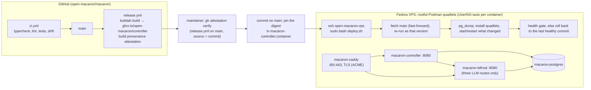

# macaron-bot — supply chain and VPS deployment

> The deployment is moving to OpenShift: [DEPLOYMENT-OPENSHIFT.md](DEPLOYMENT-OPENSHIFT.md) (#24). This document describes the VPS, which stays in production until the cutover.

Everything here is public: the repo, the images, and the unit files. So no secret ever lives in git or in GitHub. The VPS pulls its deployment from the public repo, and GitHub never gets SSH or any other credential to the VPS.



Networks: `macaron-edge` (Caddy, controller, Bifrost; outbound limited to TCP 443) and `macaron-db` (internal, no route out: Postgres, controller, Bifrost). Only Caddy publishes ports.

## 0. The VPS (checked over `ssh open-macaron-vps` on 2026-10-15)

| Item | Found | Action |
|---|---|---|
| Provider / OS | OVH VPS (Canada), Fedora 44 Cloud, kernel 7.1, KVM. Supported until 2027-05 | Plan the upgrade to Fedora 45 before then |
| Size | 2 vCPU, 3.7 GiB RAM, 40 GB disk (3 % used) | Fits; controller 768 MiB, Postgres ~512 MiB, Caddy ~64 MiB |
| Network | 51.222.37.43, 2607:5300:205:200::db3c (IPv4 + IPv6) | DNS `A` + `AAAA` for the controller hostname |
| Podman / SELinux | Podman 5.8.4, SELinux enforcing | As designed |
| SSH | Port 50485, root key-only. **Password auth is ON**: `50-cloud-init.conf` sets `PasswordAuthentication yes`, and the drop-in wins over `sshd_config`. User `fedora` has a password and passwordless sudo | ✅ **Fixed 2026-10-15:** drop-in `00-macaron.conf` sets `PasswordAuthentication no`, `KbdInteractiveAuthentication no`, `PermitRootLogin no`, `AllowUsers fedora`. Verified: key login works, password login refused. `bootstrap-host.sh` must keep this file |
| Firewall | **None**: firewalld not installed, nftables ruleset empty | Install firewalld: inbound ssh (50485), http, https only |
| Exposed services | `systemd-resolved` LLMNR on 0.0.0.0:5355 / [::]:5355 | `LLMNR=no` in resolved.conf |
| Updates | No automatic updates | `dnf5-plugin-automatic`, security only, weekly reboot window |
| Brute force | No failed logins yet (non-standard port) | fail2ban on sshd anyway |
| Service user | Only `fedora` exists; no `macaron` user, no linger; `ip_unprivileged_port_start=1024` | Created by `bootstrap-host.sh` (§3) |

## 1. Image build (`release.yml`, `packages/controller/Containerfile`)

- **Two-stage Containerfile.** It builds on `registry.access.redhat.com/ubi10/nodejs-24` and runs on `ubi10/nodejs-24-minimal`, both pinned by digest.
- **What the build does:** `pnpm install --frozen-lockfile`, `pnpm build`, then `pnpm deploy --prod` into `/opt/app`. The runtime image only gets that folder and runs as a non-root user.
- **Release:** on every push to `main`, buildah builds the image, pushes it to `ghcr.io/open-macaron/controller:sha-<commit>`, and `actions/attest-build-provenance` attaches SLSA provenance, signed by Sigstore through GitHub OIDC with no long-lived key. `release-agent-cli.yml` and `release-knowledge-cli.yml` attest their bundles the same way.
- **Workflow permissions:** top level `permissions: {}`. Only the release job gets `contents: read`, `packages: write`, `id-token: write` and `attestations: write`.
- **Verification before pinning:** `gh attestation verify oci://ghcr.io/open-macaron/controller@<digest> --signer-workflow open-macaron/macaron/.github/workflows/release.yml --source-ref refs/heads/main --source-digest <commit>`. Only a verified digest is pinned in `macaron-controller.container`; `deploy.sh` refuses an image that isn't pinned by digest.

## 2. Quadlets (`deploy/quadlets/`)

```
deploy/
├── quadlets/
│   ├── macaron-caddy.container        PublishPort 80, 443; Caddyfile from deploy/caddy/, certs in macaron-caddy.volume
│   ├── macaron-postgres.container     postgres:17-alpine@sha256:…, data in macaron-pgdata.volume
│   ├── macaron-controller.container   Requires/After postgres (and Bifrost when present); migrates at startup
│   ├── macaron-bifrost.container      LLM gateway over the upstream LLM key; only when its secrets exist
│   ├── macaron-edge.network           outbound TCP 443 only (nftables, bootstrap-host.sh)
│   ├── macaron-db.network             internal: no route out
│   ├── macaron-pgdata.volume
│   └── macaron-caddy.volume
├── caddy/Caddyfile                    host, HSTS, exact-path allow-list, request size limits
├── bifrost/                           config.template.json (+ render-config.sh), pinned pricing.json and model-parameters.json, dev.sh
└── scripts/deploy.sh, provision-secrets.sh, bootstrap-host.sh
```

Every container gets the same hardening: `UserNS=auto` (its own unprivileged ID range), `ReadOnly=true`, `DropCapability=ALL`, `NoNewPrivileges=true`, `:Z` on bind mounts (SELinux enforcing), journald logs, `Notify=healthy` so systemd waits for the health check. The controller unit is the reference:

```ini
[Unit]
Requires=macaron-postgres.service
After=macaron-postgres.service macaron-bifrost.service

[Container]
Image=ghcr.io/open-macaron/controller@sha256:…        # digest only, verified before pinning
UserNS=auto
Network=macaron-edge.network
Network=macaron-db.network
ReadOnly=true
DropCapability=ALL
NoNewPrivileges=true
EnvironmentFile=/etc/macaron/controller.env           # non-secret settings, incl. MACARON_ENABLED, LLM_BACKEND
Volume=/opt/macaron/repo/config:/opt/macaron/config:ro,Z
Secret=macaron-database-url,type=env,target=DATABASE_URL
Secret=macaron-gh-interact,type=env,target=GH_INTERACT
Secret=macaron-gh-push,type=env,target=GH_PUSH
Secret=macaron-gh-org,type=env,target=GH_ORG
Secret=macaron-bifrost-admin,type=env,target=BIFROST_ADMIN_PASSWORD
Secret=macaron-webhook-hmac,type=env,target=WEBHOOK_HMAC
HealthCmd=node -e "fetch('http://127.0.0.1:8080/healthz')…"
Notify=healthy
LogDriver=journald

[Service]
TimeoutStartSec=180                                   # migrations, then each LLM backend's start-up checks
Restart=on-failure
MemoryMax=768M
ExecReload=/usr/bin/podman kill --signal HUP macaron-controller   # reloads config/

[Install]
WantedBy=multi-user.target
```

- **Named volumes take `:U`.** `UserNS=auto` can give a container another host ID range each time it starts (the range depends on the other containers present), so a volume follows it: Podman hands it to the container's current range on start. Without it, a restart can leave Caddy unable to read its certificates (every TLS handshake fails) or Postgres unable to read its data. Postgres' entrypoint, as root, gives the data directory back to `postgres` on each start.
- **Start timeouts.** Bifrost's first boot runs about 70 s of migrations (`TimeoutStartSec=300`); the controller gets 180 s.
- **Single node.** A restart causes a few seconds of downtime and no lost work: triggers and pg-boss jobs are rows in Postgres, the notifications poller resumes from its stored cursor, and the scheduled `reconcile` job recovers `workflow_run` webhooks that arrived while it was down.
- **Migrations** run when the controller starts, before it serves anything: Drizzle's migrator inside the database module's factory, under a Postgres advisory lock. pg-boss migrates its own `pgboss` schema the same way. Migrations must only add or widen columns, so a rollback to the previous digest keeps working. A destructive change ships in two releases.

### `deploy.sh`

Run on the VPS only, over ssh: `ssh open-macaron-vps 'sudo bash /opt/macaron/repo/deploy/scripts/deploy.sh'`.

1. **Prerequisites:** `controller.env`, `caddy.env` and the required secrets exist. Bifrost is deployed only when `macaron-llm-upstream-key` and `macaron-llm-upstream-url` exist.
2. **Fetch:** fast-forwards `/opt/macaron/repo` to `origin/main`, then re-runs itself as the version just checked out (the whole script is one function, parsed before it runs, so the checkout can't change it mid-run).
3. **Diff** against the last healthy commit, recorded in `/etc/macaron/deployed-commit`, so a deploy that failed half-way still restarts everything that changed since.
4. **`pg_dump`** before changing the controller or the quadlets (`/var/backups/macaron`, 30 days).
5. **Install** the quadlets, create Bifrost's role and database if needed, render its config with the upstream's URL.
6. **Start or restart** what changed (a unit that isn't active is restarted, not started, so a crash-looping unit picks up its new definition). Bifrost isn't restarted while runs are unsettled: it writes spend to Postgres only every 10 s.
7. **Health gate:** every unit active within 2 minutes; otherwise, and on any failed start, it rolls back to the last healthy commit.

## 3. Host (`deploy/scripts/bootstrap-host.sh`, run once as root)

| Area | Setting |
|---|---|
| OS | Fedora (current release), `dnf5-automatic` installing security updates, reboot after them |
| Access | SSH keys only, no root login, no password auth, `AllowUsers`; `fail2ban` on sshd |
| Firewall | `firewalld`: only the SSH port, `http`, `https` inbound (applied with a 5-minute automatic rollback) |
| Egress | nftables on the `macaron-edge` bridge: outbound TCP 443 only |
| Resolver | `systemd-resolved` without LLMNR or mDNS |
| Containers | Rootful Podman quadlets; the `containers` user owns the ID pool `UserNS=auto` hands out, one unique range per container |
| SELinux | Enforcing; bind mounts use `:Z` |
| Remote Podman | the admin user reaches the Podman API over ssh (the `podman` group owns the socket) |
| Disk | Podman's file secret driver stores values on disk readable by root: rely on the provider's disk encryption where available |

## 4. Secrets (created over SSH by `provision-secrets.sh`, never in git)

| Podman secret | Content | Rotation |
|---|---|---|
| `macaron-gh-interact`, `macaron-gh-push`, `macaron-gh-org` | PATs of macaron-bot, scopes in REPOSITORIES.md §3 | ≤ 90 days |
| `macaron-llm-upstream-url` | the upstream's Anthropic-compatible URL, kept out of the public repository; `deploy.sh` renders it into `/etc/macaron/bifrost-config.json` | when it moves |
| `macaron-llm-upstream-key` | the upstream LLM key; with the URL, its presence turns Bifrost on | as the company requires |
| `macaron-bifrost-admin`, `macaron-bifrost-db-password` | Bifrost's admin password (shared with the controller) and database password, generated on the VPS | on demand |
| `macaron-bifrost-encryption-key` | encrypts the keys Bifrost stores; generated once | **never**: Bifrost can't change it without wiping its database |
| `macaron-webhook-hmac` | shared with the `open-macaron/runner` webhook (+ any upstream admin who installs our webhook) | yearly |
| `macaron-database-url`, `macaron-pg-password` | generated on the VPS, once | on demand |
| `macaron-or-provisioning`, `macaron-or-router` | OpenRouter keys, optional: not mounted while `LLM_BACKEND=bifrost` (the keys are disabled) | 90 days if used |

`provision-secrets.sh` reads values from `~/.config/macaron/dev.env` and sends each over ssh stdin (`podman secret create --replace <name> -`): they never go through a shell history, a file in the repo, or GitHub. It also writes `/etc/macaron/controller.env` and `caddy.env`, keeping the current `MACARON_ENABLED`, `MACARON_ALLOWED_USER_IDS` and `LLM_BACKEND` unless they're given explicitly.

## 5. Operations

- **Logs:** journald (`journalctl -u macaron-controller`, `-u macaron-bifrost`, …), as JSON lines from pino with secrets redacted.
- **Backups:** the VPS provider backs up the whole machine automatically. Those snapshots are crash-consistent, which Postgres recovers from on start through its WAL. In addition, `deploy.sh` takes a local `pg_dump` before changing the controller, so a bad migration can be undone without restoring the whole VPS.
- **Kill switch:** set `MACARON_ENABLED=false` in `controller.env` and restart. The controller stops ingesting and refuses to launch runs. `systemctl stop macaron-controller` is the hard stop; open keys still expire on their own and the sweeper deletes them on the next start.
- **LLM backend.** Production uses Bifrost over the upstream LLM key (`LLM_BACKEND=bifrost`). To set it up on a fresh VPS:
  1. Put `LLM_UPSTREAM_URL` and `LLM_UPSTREAM_KEY` in `~/.config/macaron/dev.env` and run `provision-secrets.sh`: it creates their secrets and, once, Bifrost's generated ones.
  2. Run `deploy.sh`: it creates Bifrost's role and database in the shared Postgres, renders its config, then starts `macaron-bifrost` before the controller.
  3. Use the upstream's model names in `config/global.yaml` (`claude-sonnet-5-5`, `claude-haiku-4-5`…) and run `LLM_BACKEND=bifrost provision-secrets.sh`, then restart the controller.

  Models must be priced in `deploy/bifrost/pricing.json`: the controller refuses to start when the active backend can't price a configured model, and refuses to mint keys for one after a config reload. A configured backend that isn't active and fails its start-up check is logged and left out. Locally, `deploy/bifrost/dev.sh up` starts the same stack for `pnpm test:live` (with `BIFROST_ADMIN_URL=http://127.0.0.1:18080` and `BIFROST_PUBLIC_URL=https://localhost:18443/llm/anthropic` in `dev.env`).
- **User allowlist:** `MACARON_ALLOWED_USER_IDS=<id>,<id>` in `controller.env` limits who can trigger the bot to those numeric GitHub user ids, whatever `config/` trusts. Ids rather than logins, because a login can be renamed and re-registered. Restart to apply.

## 6. Open points

1. **Monitoring and alerts:** nothing exports metrics or sends alerts yet. Wanted: spend in the last hour, open keys older than 1 h, event lag, a failing poller, tokens close to expiry, and a dead-man's switch. Channel to pick (e-mail, Matrix, ntfy…).
2. **Domain:** the controller uses the provider's hostname (`vps-….vps.ovh.ca`). `ovh.ca` isn't on the Public Suffix List, so Let's Encrypt rate limits are shared; a domain of our own would avoid that.
3. **Signature check at pull time:** verification happens before pinning, by a maintainer. Checking it on the VPS too (`cosign verify-attestation` or Podman's `policy.json`, which matches signers by email rather than workflow URI) is still open.
4. **Image updates:** base images and the Bifrost image are bumped by hand; Renovate isn't set up.
