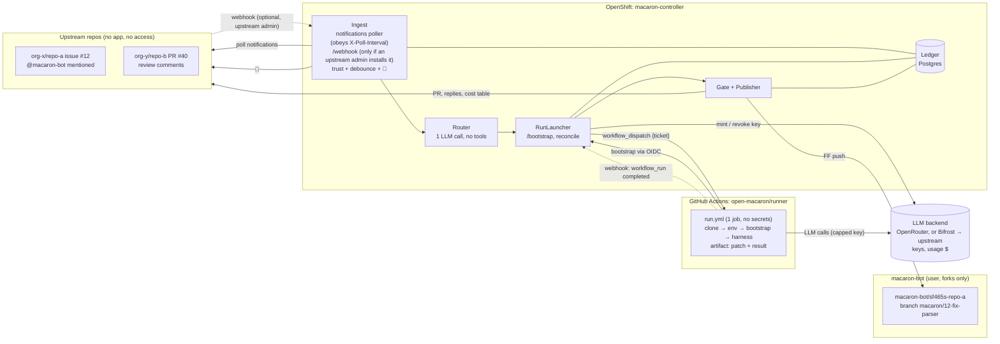
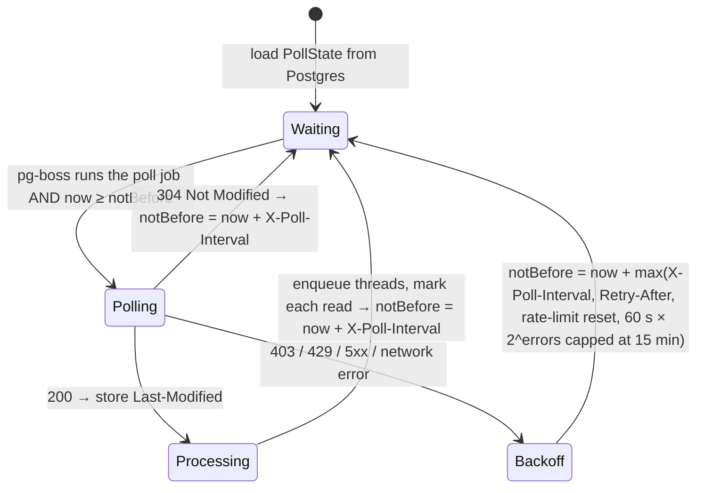
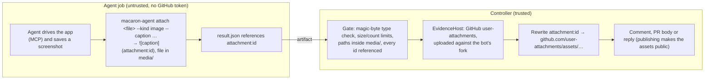

# macaron-bot — design draft

Companion docs:
- [SCALING.md](SCALING.md): environments (shared/own/upstream), config hierarchy, limits;
- [REPOSITORIES.md](REPOSITORIES.md): the `open-macaron` org, its repos, accounts, tokens and onboarding;
- [ENGINEERING.md](ENGINEERING.md): stack, code layout, quality gates;
- [DEPLOYMENT.md](DEPLOYMENT.md): supply chain, OpenShift deployment.

## 1. Why

- ~30 upstream repos across many orgs; we can't install GitHub Apps there, and `macaron-bot` **never has any access to them**: no collaborator role, no org membership. It acts exactly like an outside contributor, working from forks (see "Operating as an outside contributor").
- We want a bot account (`macaron-bot`) that is mentioned on an issue and then plans, asks questions, or opens a PR. It also handles review loops on its own PRs.
- Agents (claude / codex / opencode) run on GitHub-hosted runners, so we don't manage agent environments.
- A **controller in our OpenShift namespace** holds every credential and does everything deterministic: polling, webhooks, reactions, budget keys, policy checks, pushes, comments.
- Security comes first. The agent never holds a GitHub credential. Every agent run gets its own budget-capped LLM key: a Bifrost virtual key over the upstream LLM key, or an OpenRouter key (§4 "Budgets"). Pushes are done afterwards by deterministic code that only writes to one branch.
- The bot only works for allow-listed repos and users. It reacts fast (👀), comments little, reports the cost of every action, and learns over time through a curated knowledge base.

## 2. Target architecture



**Event sources.**
- *Notifications* are the only signal we get from the upstream repos. We act on three reasons:
  - `mention`: the trigger, §8.4;
  - `author`: reviews and comments on the bot's own PRs;
  - `comment`: follow-ups on threads the bot has already replied in.

  `review_requested` can't happen, because a reviewer must have access. `assign` only happens if a maintainer assigns the bot after it has commented on that issue; it's treated like a bare mention. The controller polls notifications with conditional GETs (§4).
- *Webhooks* are instant. They work for upstream repos whose admins opt in, and for **our own org**, `open-macaron`: a webhook on the `runner` repository delivers `workflow_run` events from `runner`, which tell the controller that an agent finished. We own the org, so this always works.

**Why a controller of our own.** GitHub holds **no secrets at all**. The prepare, gate and publish jobs leave Actions, which saves about 20–40 s of runner start-up per job and is a real speed gain. The controller can also revoke a key mid-run.

## 3. Trust boundaries

On GitHub-hosted runners, any secret a job references can be read by every step of that job, because steps run with sudo and can read the runner process's memory. With this design, the agent job references none.

```mermaid
sequenceDiagram
  box rgb(230,245,230) Controller on OpenShift (trusted, all secrets)
    participant C as Controller
  end
  participant OR as LLM backend (OpenRouter or Bifrost)
  box rgb(250,230,230) GitHub Actions job: agent (permissions: id-token write only)
    participant J as run.yml
  end

  Note over C: launch(thread, mode)
  C->>C: trust + ledger caps (refuse → 😕 + reply)
  C->>OR: POST /keys {limit}
  OR-->>C: key → stored under ticket with context
  C->>J: workflow_dispatch {ticket, repo, baseSha, branch, env, runs-on}
  J->>J: clone upstream@baseSha + fork branch (anonymous)
  J->>J: env: composite from shared | own | upstream (SCALING.md §1)
  J->>C: POST /bootstrap {ticket, OIDC token aud=macaron}
  C->>C: verify OIDC claims, redeem ticket ONCE, bind run_id
  C-->>J: key + context (key masked, harness env only)
  Note over J: harness runs — UNTRUSTED from here on
  J->>OR: LLM calls with the capped key
  loop watchdog
    C->>OR: live usage, wall-clock → abort revokes the key
  end
  J->>J: upload artifact: changes.patch + result.json
  J-->>C: webhook: workflow_run completed
  C->>OR: disable key now (spending stops); settle-cost job ~90 s later: final usage → ledger → delete key
  C->>C: download artifact → Gate (policy)
  Note over C: Publisher: commit, FF push, replies, cost table, 👀 → 👍/😕
```

- The OIDC check requires `repository_id` and `repository_owner_id` (immutable), of `open-macaron/runner`, `workflow_ref=open-macaron/runner/.github/workflows/run.yml@refs/heads/main`, `event_name=workflow_dispatch`, `actor=macaron-bot` and `runner_environment=github-hosted`: a runner label in the configuration can't send a key to a machine we don't control.
- A ticket can be redeemed only once. The legitimate bootstrap step uses it before the agent starts, so an agent that mints its own OIDC token gets nothing. The environment step runs *before* bootstrap. If environment code redeems the ticket first, the real bootstrap gets a 409 and the controller revokes the key at once: at worst a failed run, never a leaked credential.
- The agent job has no endpoint for submitting results. The controller *pulls* the artifact.
- **With the Bifrost backend, a credential-holding service runs next to the controller.** Bifrost holds the upstream LLM key, which has no cap of its own and can't derive keys. Runners reach it only through three exact edge routes (messages, token counting, model list), each forwarded to its canonical path; its admin API and UI are reachable only from the controller (NetworkPolicy). Its configuration file is authoritative over its database at every start, auth is enforced on inference, and stored keys are encrypted. Anyone holding the admin password can still change settings until the next restart, so that password exists only in the controller and Bifrost.

## 4. Components (`packages/controller/`, NestJS — module map in ENGINEERING.md §3)

```ts
class Ingest {
  constructor(gh: GitHubClient, trust: TrustList, ledger: Ledger, router: Router, poller: NotificationsPoller) {}
  /** POST /webhook — only for upstream repos whose admins install our webhook (HMAC-verified). Not assumed. */
  onUpstreamWebhook(ev: WebhookEvent): Promise<void>;
  /** 👀 immediately; hand the thread to the Router once it has been quiet for 60 s (one review = one run). */
  schedule(ev: TriggerEvent): Promise<void>;
}

/** The only code allowed to call GET /notifications. Runs as a pg-boss job: one active across instances. */
class NotificationsPoller {
  constructor(source: NotificationsApi, state: PollStateStore, sink: NotificationSink, scheduler: PollScheduler, clock: Clock) {}
  /** Polls only if now ≥ state.notBefore (otherwise reschedules), persists the new state, schedules the next poll. */
  tick(): Promise<NotificationThread[]>;
}

interface PollState {            // one row in Postgres, survives restarts and deploys
  lastModified: string | null;   // sent back as If-Modified-Since
  intervalSec: number;           // last X-Poll-Interval seen (floor 60)
  notBefore: Date;               // earliest moment the next poll is allowed
  consecutiveErrors: number;
}

class Router {
  /** One tool-less LLM call on the thread text: "thanks!" → noop, question → triage, changes → address_review. */
  route(thread: ThreadSnapshot): Promise<{ mode: Mode | "noop"; reason: string; costUsd: number }>;
}

class RunLauncher {
  constructor(gh: GitHubClient, budgets: BudgetService, ledger: Ledger, publisher: Publisher) {}
  /** Caps check → mint key → store ticket → workflow_dispatch(run.yml, { ticket, repo, baseSha, branch, env, runsOn }). */
  launch(thread: ThreadRef, mode: Mode): Promise<Ticket>;
  /** POST /bootstrap — verify OIDC, redeem ticket once, bind run_id. */
  bootstrap(oidc: string, ticket: string): Promise<BootstrapPayload>;
  /** workflow_run completed → settle key, fetch artifact, Gate, Publisher; escalate if asked. */
  complete(run: WorkflowRun): Promise<void>;
  /** /stop, budget watchdog, or timeout → disable key now, cancel the run. */
  abort(ticket: string, reason: string): Promise<void>;
  /** Every 2 min: runs still pending in the ledger are checked via the API, so a webhook missed during a restart is never lost. */
  reconcile(): Promise<void>;
}

interface BootstrapPayload {
  llm: { baseUrl: string; key: string; fastModel: string }; context: RunContext;
  clone: { upstream: string; baseSha: string; fork: string; branch: string };
}
```

Behaviour notes:
- **The Router isn't implemented yet.** Today an explicit command picks the mode, review comments on the bot's pull request mean `address_review`, and anything else (a bare mention) is a `triage` run. The plan: one tool-less call with its own small daily-capped key, its cost in the ledger, so a "thanks!" costs about $0.001 and never starts a runner.
- Run modes:
  - `triage`: read-only, no setup step, small budget. It answers questions in a thread.
  - `plan`, `implement`, `address_review`: full environment.
  - `reproduce` (on the default branch) and `verify` (on the pull request): full environment, **no commit**. They reply with evidence: commands and their output, and screenshots or videos where the environment can show the application (see "Evidence" below). `@macaron-bot can you reproduce?` routes here.
  - A run may return `escalate`, in which case `complete()` launches the next run in the requested mode.
  - Explicit commands (`@macaron-bot implement`, `/plan`, `/stop`) skip the Router.
  - `@macaron-bot retry` runs the thread's last failed or stopped loop again, with the same mode, trigger and platform. It is refused when the last loop succeeded. Each failure's status comment says so.
  - **Platforms.** Runs are on Linux unless the command names another platform the repo enables: `@macaron-bot reproduce on windows` (the first `on <platform>` of the mention's line). An escalation keeps the escalating run's platform unless the result sets `escalateOn`; triage is told which platforms the repo has, for issues that only happen on one. `triage` and `review` don't set the project up, so they always run on Linux. The status comment names the platform.
- The Ingest drops events from untrusted repos, untrusted users, and the bot itself. It also caps loops: at most N review loops per PR, and a lower cap when the reviewer is a bot, so two bots can't ping-pong forever.
- Review *summaries* don't support reactions, so 👀 goes on the PR.

### Subjects and routes (`src/routing/`)

A thread is an issue and the bot's open pull request for it, but they are separate **subjects** (GitHub's term in notifications): the issue is for understanding the problem and starting the work, a pull request for checking and continuing a change. Each request is answered on its subject: its loop's status comment, its message, its refusal.

`ROUTES` (`routes.ts`) is the one table that says, per subject and mode, which commit a run starts from or why the request is refused. `route()` applies it to one request, with its platform; the result is stored on the run (`runs.route`) and everything after launch follows it.

| Subject | Mode | Checkout | Otherwise |
|---|---|---|---|
| issue | `triage`, `plan`, `reproduce` | default branch | |
| issue | `implement` | default branch, on a new branch if the bot had one; supersedes the bot's open pull request | |
| issue | `verify`, `review` | | refused: "runs on the pull request: mention me on #N" |
| bot's pull request | `triage`, `address_review`, `verify` | bot's branch | |
| any pull request | `review` | pull request head | |
| another pull request | `triage`, `verify` | pull request head | |
| any pull request | `implement`, `plan` | | refused: "can only be used from an issue" |
| any pull request | `reproduce` | | refused: "can only be used from an issue. On a pull request, use `review` or `verify`" |

- **One subject at a time, one run at a time per thread.** The worker takes the subject of the oldest pending request; requests on the other subject wait for the next pass. The thread keeps one ledger and one set of caps.
- **Superseding.** A fresh `implement` opens its new pull request first, then closes the bot's previous one with "Superseded by #N", so a failed attempt never leaves the issue without one. No history of earlier pull requests is kept.
- **A merged or closed bot pull request is forgotten** when the thread is next read (`ThreadStates`): the next `implement` starts over.
- **Reactions.** 👀 waits unclaimed when a request arrives; the loop answering its subject claims it and swaps it for 👍 or 😕.

### Notification polling rules

GitHub's documentation: *"There is an `X-Poll-Interval` header that specifies how often (in seconds) you are allowed to poll. In times of high server load, the time may increase. Please obey the header."* We treat it as a hard contract:



1. **The header always wins.** Every response (200, 304, error) updates `intervalSec` from `X-Poll-Interval`. If it is missing, the last known value is kept, and never less than 60 s. The poller has no "poll now" path: no deploy, webhook, command or admin endpoint can trigger an early poll.
2. **`notBefore` is persisted before the next sleep.** A restart, a crash loop or a deploy every five minutes can never cause an extra request.
3. **Exactly one poller.** A second controller instance would double the rate. The poll is a pg-boss job on a `stately` queue with one key, so at most one runs at a time across instances. It reschedules itself for exactly `notBefore`; a once-a-minute cron entry only guarantees a poll stays pending, and a job that wakes early makes no request.
4. **Conditional requests.** `If-Modified-Since` carries the stored `Last-Modified`, so a 304 costs no rate limit.
5. **One poll is one logical request.** We use `participating=true` (only direct involvement: `mention`, `author`, `comment`, rarely `assign`). We mark threads as read after enqueueing (`PATCH /notifications/threads/{id}`), and auto-watch is off on the bot account, so a poll fits in one page (`per_page=50`). If `Link: next` appears, the remaining pages are fetched within the same poll. A warning metric fires, because it means the inbox isn't being drained.
6. **Errors back off, they never retry fast.** The wait is `Retry-After`, the rate-limit reset, or an exponential backoff, whichever is longest, and never shorter than the poll interval.
7. **Pinned API version.** All Octokit clients send `X-GitHub-Api-Version: 2026-03-10`. These endpoints only accept a classic PAT with the `notifications` scope, which is `GH_INTERACT`.

Latency is therefore *at least* one poll interval (typically ~60 s, more when GitHub is under load). When an upstream repo installs our webhook, it is the fast path; polling remains the floor.

### Budgets (`BudgetModule`)

```ts
/** One per configured backend (OpenRouterKeys, BifrostKeys); LLM_BACKEND picks the one new runs use. */
abstract class RunKeys {
  readonly backend: "openrouter" | "bifrost";
  readonly baseUrl: string;      // what runners use as ANTHROPIC_BASE_URL
  readonly usageLagMs: number;   // wait after freezing before usage is worth reading
  create(name: string, limitUsd: number, expiresAt: Date, models: readonly string[]): Promise<ProvisionedKey>;
  disable(hash: string): Promise<void>;
  delete(hash: string): Promise<void>;
  listByPrefix(prefix: string): Promise<KeyStatus[]>;
  spentSince(hash: string, since: Date): Promise<number>;
}

class BudgetService {
  /** On the active backend: capped at limitUsd, limited to `models` where the backend can, expiring after ttlMinutes. */
  mint(runId: string, limitUsd: number, ttlMinutes: number, models: readonly string[]): Promise<MintedKey>;
  /** Every other call goes to the backend recorded on the run (`runs.key_backend`), whichever is active now. */
  freeze(key: RunKeyRef): Promise<void>;
  usage(key: RunKeyRef, since: Date): Promise<UsdMicros>;
  revoke(key: RunKeyRef): Promise<void>;
  /** Run keys on every configured backend, for the sweeper. */
  runKeys(): Promise<SweepableKey[]>;
}
```

- **Two backends.** OpenRouter mints real keys with a limit and an expiry. Bifrost (a self-hosted gateway, `deploy/openshift/bifrost.yaml`) holds the upstream LLM key and mints virtual keys over it with a budget, an expiry, an allowlist of the run's model and fast model, and a per-minute request limit. Each run records where its key was minted, so switching `LLM_BACKEND` never strands a run's key.
- **Start-up checks.** Each configured backend checks itself when the controller starts (OpenRouter resolves its workspace, `OPENROUTER_WORKSPACE`; Bifrost loads its prices). The active backend must pass, and must price every model the configuration uses; another backend that fails is logged and left out, since it only matters for runs minted on it.
- **OpenRouter keys live in one workspace,** so its dashboard is the bot's total spend there, and a workspace budget can act as a hard global ceiling on top of our caps.
- **Costs are settled in two phases.** Backends report a key's usage asynchronously (OpenRouter ~25 s after the call; Bifrost writes spend every 10 s). At completion the key is frozen and the result is published immediately. A `settle-cost` job runs after the backend's `usageLagMs` (90 s for OpenRouter, 15 s for Bifrost), writes the final cost to the ledger once, deletes the key and refreshes the PR's cost table, where the loop shows "settling…" until then. A run's whole limit counts against the caps until it is settled, so nothing can overshoot in between.

- Caps exist at four levels: per-run key limit, per thread, per repo per month, and global concurrency. There is also a kill switch (`MACARON_ENABLED`).
- Every run key expires on its own (`expires_at` = timeout + 15 min). A `sweep-keys` pg-boss cron job deletes leftovers, as a safety net: keys of unsettled runs are kept until they are older than the longest allowed run plus grace and settlement (`KEY_MAX_AGE_MS`, derived from `MAX_TIMEOUT_MINUTES`). Each run's fast model is stored at launch with its model, since its key allows only those two.
- The last request can overshoot a key's limit a little, so harness `max_tokens` stays bounded. OpenRouter refuses a request whose worst case exceeds what's left. Bifrost checks the budget before a request and charges it after, with no reservation, so parallel requests can each overshoot; its per-key request limit is counted the same way and doesn't stop a burst. The bound is Bifrost's provider-wide cap: 16 requests in flight plus 16 queued, the rest dropped (measured: a burst of 40 ran 32).
- **Bifrost only charges priced models.** A model without a price costs $0, so its budget would never trigger. Prices are pinned in `deploy/bifrost/pricing.json` for exactly the allowed models, the controller refuses to start when the active backend can't price a configured model (e.g. names written for the other backend), and `BifrostKeys` refuses to mint a key for a model without one after a config reload.

### Gate and Publisher (`PublishModule`)

```ts
class Gate {
  /** Rejects: .github/** changes, secrets (gitleaks), binaries, > N files/lines, a mode/action mismatch (triage can't commit). */
  check(mode: Mode, patch: Patch, result: RunResult): Verdict;
}

class Publisher {
  /** One commit per loop, bot author, signed; FF-only push to the ledger-owned branch (never one named by the agent). */
  pushLoop(thread: ThreadRef, patch: Patch, message: string): Promise<string>;
  /** Threaded replies first, then the loop's own status comment (where the request was made), then at most 1 top-level comment. */
  respond(thread: ThreadRef, result: RunResult): Promise<void>;
  /** Rewrite the <!-- macaron:cost --> section of the PR body from the ledger. */
  renderCostTable(pr: PullRef): Promise<void>;
}
```

The controller has three GitHub tokens, all in its own Kubernetes Secret. Exact scopes and why each is shaped that way are in REPOSITORIES.md §3:

| Token | Type | Can do |
|---|---|---|
| `GH_PUSH` | fine-grained PAT, owner macaron-bot | Contents and Workflows write on its repos, which are only forks. Workflows is needed to carry upstream's own commits into a fork (sync, new branch) when they touch `.github/workflows/`, which active upstreams do weekly. It adds no reach: the forks hold no secrets and keep Actions disabled, a fork's pull request runs upstream CI as untrusted whatever it contains, and the Gate and `ForkCommitter` both refuse any bot change under `.github/` |
| `GH_INTERACT` | classic `public_repo` PAT | Comments, reactions, PRs, notifications on upstream repos; blocked from `open-macaron` by org policy |
| `GH_ORG` | fine-grained PAT, owner open-macaron | `runner`: Actions write (start and cancel runs); `knowledge`: Pull requests write (`remember:` proposals) |

### Harness contract (`harness/<name>/run.sh`, `packages/contracts`)

For Claude Code the adapter sets `ANTHROPIC_BASE_URL=<llm.baseUrl>` (OpenRouter's `https://openrouter.ai/api`, or the edge's `/llm/anthropic` route to Bifrost), `ANTHROPIC_AUTH_TOKEN=<llm.key>`, `ANTHROPIC_API_KEY=""`, and the Haiku slot to `llm.fastModel`.

```ts
type Mode = "triage" | "plan" | "implement" | "address_review" | "reproduce" | "verify" | "retro";

interface RunContext {
  mode: Mode; repo: string; number: number; branch: string; baseSha: string;
  trigger: { kind: "assign" | "mention" | "review" | "comment"; url: string };
  thread: Comment[]; reviewComments: ReviewComment[];   // untrusted text; IDs are kept for replies
  priorLoops: LoopSummary[]; knowledge: KnowledgeSlice;
}

interface RunResult {
  action: "reply" | "plan" | "ask" | "commit" | "escalate" | "noop";
  escalateTo?: Mode; commitMessage?: string; prTitle?: string; prBody?: string;
  replies: { inReplyTo: number; body: string }[];        // bodies may embed 
  summary: string;
  attachments: { id: string; path: string; kind: "image" | "video"; caption: string; preview?: string }[];
  learnings: { scope: "global" | "repo"; topic: string; text: string; evidence: string }[];
}
```

`config/` lives in `open-macaron/macaron`. Changes need CODEOWNERS review; `deploy.sh` delivers them as a ConfigMap, which rolls the controller. It holds, per global/project/repo level, the users and bots allowed to trigger, harness and model, environment, budgets and caps (SCALING.md §2).

### Environments and configuration

There is one workflow, `open-macaron/runner/.github/workflows/run.yml`. Each repo's environment is a **composite action** that `run.yml` loads at runtime from one of three sources:
- **shared:** a family environment with parameters, for example all Podman Desktop extensions;
- **own:** a folder in `runner` owned by the repo's team;
- **upstream:** shipped in the upstream repo and read at the base SHA, for example Podman Desktop itself.

Configuration is a hierarchy, `config/global.yaml` → `projects/<p>/project.yaml` → `projects/<p>/repos/<r>.yaml`. The project is the unit for budget, trusted users and ownership. The full reasoning, examples and scaling limits are in [SCALING.md](SCALING.md).

### Evidence: screenshots and videos

**The repo's tooling shows the app; the environment gives the agent the means; the controller publishes.** For Podman Desktop extensions, the `podman-desktop-extensions` environment (open-macaron/runner) starts Podman Desktop with the extension on a virtual display, with CDP on port 9222. The agent drives it through Podman Desktop's own `mcp-testing` skill (its MCP server, prompt and selectors), saves screenshots with the environment's `tools/screenshot.mjs`, and rebuilds and restarts with `podman-desktop.sh` after changing code. The environment tells the agent all this through `$RUNNER_TEMP/macaron-env/AGENTS.md`, and gives the harness `mcp.json`.



- **Hosting: GitHub user-attachments,** the files GitHub serves for media pasted into issues. Images render inline, and so do videos, with a player. No dedicated repository and no git history.
- **How it's uploaded:**
  - the same request as `gh issue comment --attach` (GitHub CLI ≥ 2.99): `POST https://uploads.github.com/user-attachments/assets?name&content_type&repository_id`, through our Octokit client, with `GH_PUSH`;
  - GitHub documents the CLI flag, not the endpoint. So the answer is validated with Zod, and a live test (`evidence.live.test.ts`) catches changes.
- **The bot's fork as `repository_id`:**
  - the endpoint requires write access to that repository and answers 404 otherwise; the bot only writes to its forks;
  - an asset stays private to the bot until a saved comment references it, then becomes public (measured: about 20 s, on a repository other than the fork).
- **Each file is uploaded once per loop** (effects), so a retried publish reuses it.
- **Limits:**
  - allowed types: png, jpeg, webp, gif, webm, mp4;
  - at most 20 files and 50 MB per run.

  The controller only checks magic bytes and sizes. It never decodes or transcodes media, so it doesn't parse untrusted files.
- **Videos (later):** `ffmpeg -f x11grab` on the virtual display, uploaded the same way.
- **On every repository.** `reproduce` and `verify` aren't gated on what an environment can show: a CLI needs no display, and each environment's action decides what it sets up. The environment's instructions tell the agent what it can show, and the agent says so when it can't show the problem.
- **On every platform the repo enables.** One environment action covers them all, with platform-specific steps under `if: runner.os == 'Windows'`. On Windows the app runs on the runner's desktop session (no virtual display) and Podman comes with a WSL machine (redhat-actions/podman-install). Hosted macOS runners have no nested virtualization, so no Podman machine: macOS waits for a runner of our own.

### Operating as an outside contributor

With no access, the bot can do anything a stranger can do on a public repo and nothing more. Here is what it can rely on and what it has to handle:

| Can do (no access needed) | Can't do | How we handle it |
|---|---|---|
| Comment, reply to review threads, react | Label, assign, request reviewers, set milestones | Status lives in each loop's status comment. Maintainers triage as they would for any contributor |
| Open PRs from its fork, edit its own PR title/body, mark draft → ready, close its own PR | Push to upstream branches, merge | Cost table and status in the PR body; humans merge |
| Read everything public (code, issues, checks, logs) | **Run upstream CI on its PRs without approval**: fork PRs from outside contributors often need a maintainer to click "Approve and run" | The agent runs build and tests in *our* runner before publishing. The sticky comment says "upstream CI awaiting maintainer approval". The controller reads the public check runs on the head SHA and can offer a `fix-ci` loop. That loop is off by default and enabled per repo in config |
| — | Comment on **locked** conversations or repos with **interaction limits** | Publisher treats 403/422 as "can't post here". It records this in the ledger, revokes nothing, and doesn't retry. The run's cost still lands in the ledger |
| — | Bypass contribution requirements | Per-repo config `contribution: { dco: true }` makes the Publisher add `Signed-off-by: macaron-bot <…>` to each commit (Podman Desktop requires DCO). A CLA is signed once per upstream org by a maintainer for the bot account, as part of onboarding |

**Later: if the bot gets minimal access.** We start without access, but nothing in the design prevents adding it per upstream org. With read-only org membership or a triage role:
- the `assign` and `review_requested` notification reasons become first-class triggers;
- labels (`macaron:plan`, `macaron:stop`) become possible.

Each trigger maps to the same `TriggerEvent`, so it only touches `Ingest`. Config gains `access: none | read | triage` per repo, and the controller uses the extra triggers only where config says the access exists. The security model doesn't change: tokens stay in the controller, and the agent still has none.

Mentions from untrusted users on trusted repositories get 👎 and nothing else: no reply, no LLM call. A reaction notifies no one, and it tells the author they were heard but not allowed, which silence couldn't tell apart from an outage. It's given once per user and thread, at most 30 an hour across all threads, so strangers can't spend the write quota real work needs. Mentions on other repositories stay ignored silently: the bot doesn't advertise itself where it isn't enrolled. Follow-up comments on threads the bot is in arrive as `comment` notifications and go through the same trusted-user filter before the Router sees them.

## 5. Review loop and reporting

```mermaid
sequenceDiagram
  Reviewer->>Upstream PR: review (3 inline comments)
  Controller->>Upstream PR: 👀 (next allowed poll, per X-Poll-Interval; instant if webhook)
  Controller->>Controller: 60 s quiet → Router: "2 change requests, 1 question"
  Controller->>Actions: dispatch run.yml {ticket} mode=address_review
  Actions->>Controller: bootstrap (OIDC) → key + context
  Actions-->>Controller: workflow_run completed (webhook)
  Controller->>Fork branch: FF push "address review #2"
  Controller->>Upstream PR: threaded replies, cost table row 2, 👀 → 👍
```

Comment discipline:
1. Threaded replies to review comments first.
2. Then one status comment per loop, posted where the request was made, right after it: created when the run starts (⏳ and its run link), edited when it ends (outcome, cost). Earlier loops' comments are never rewritten, so every request keeps its answer and its run link.
3. A new top-level comment only when asking the human something, and at most one per run.

The PR body ends with a section that the Publisher regenerates from the ledger on every loop:

```md
<!-- macaron:cost:start -->
| Loop | Trigger | Mode | Model | Cost | Run |
|---|---|---|---|---|---|
| 1 | #12 mention by @alice | implement | sonnet-5.5 | $1.84 | [run](…) |
| 2 | review by @alice | address_review | sonnet-5.5 | $0.62 | [run](…) |
| 3 | question by @bob | triage | haiku-5.5 | $0.03 | [run](…) |
| – | 4 routed comments | router | haiku-5.5 | $0.004 | |
| **Total** | | | | **$2.49** | |
<!-- macaron:cost:end -->
```

## 6. Knowledge and rules (`open-macaron/knowledge`)

The knowledge repository holds two kinds of content, with different authors and uses:

| | **Rules** | **Lessons** |
|---|---|---|
| What | What changed code must look like ("use Svelte 5 runes") | Facts learned ("e2e tests need `xvfb-run`", "reviewers prefer small PRs") |
| Written by | Humans (the folder's owners) | The bot proposes, the folder's owners approve |
| Used for | Implementing, and the per-rule review (§6.3) | Context for the agent |
| Loaded | Only rules whose globs match the files in play (reviews) | As skills in every working run: names and descriptions in context, a body when the agent loads it |
| Identity | Stable id (`sandbox/no-runtime-json-read`), cited by review tables; never reused | File name |

A lesson becomes a rule only when a human promotes it: the bot never writes rules, because the reviewer enforces them. Nothing is read from upstream repositories for now (beyond the harness loading their `AGENTS.md` / `CLAUDE.md` natively).

### 6.1 Layout

```
knowledge/
├── README.md                    how to write rules and lessons
├── .github/workflows/           check.yml, review.yml, merge.yml, pages.yml (platform team only)
├── global/
│   ├── OWNERS.yaml              the platform team
│   ├── rules/<slug>.md          every repo (commit messages, PR etiquette)
│   └── lessons/<topic>.md       working with macaron, harness tips
├── projects/<project>/          same names as macaron's config/projects/<project>
│   ├── OWNERS.yaml
│   ├── rules/<slug>.md
│   ├── rules/<category>/<slug>.md   optional grouping: tests/, svelte/, …
│   └── lessons/<topic>.md
└── repos/<owner>/<repo>/        the upstream slug, not the fork
    ├── OWNERS.yaml
    ├── overview.md              layout, build/test quirks; always inlined in the prompt
    ├── rules/<slug>.md
    └── lessons/<topic>.md
```

A rule's scope comes from its folder, never from a field its author picks: rules in `projects/a/` only reach project `a`'s repositories. A rule's id is `<scope>/<slug>`, or `<scope>/<category>/<slug>` for a rule filed in a category folder (ESLint-style ids such as `podman-desktop/tests/prefer-reset-all-mocks`). `<scope>` is `global`, the project name or `<owner>/<repo>`; `<slug>` is the file name. Categories are one kebab-case level, in any owned folder, and can't be named `lessons` (lesson ids are `<scope>/lessons/<topic>`). The index is generated from front matter, never committed.

`OWNERS.yaml` is our format; GitHub doesn't read it, and there is no `CODEOWNERS` for these folders (§6.4). Owners are matched by **numeric user id**: a login can be renamed and re-registered. The login is there for display and mentions; `check.yml` verifies that it still resolves to the id.

```yaml
owners:
  - login: axel7083
    id: 42176370
```

### 6.2 Rule format

Rules are written to be checked one at a time by a cheap model: one checkable thing per rule, with a narrow yes/no question and examples. The schema (`@open-macaron/contracts`) and `check.yml` enforce the front matter and the four sections.

````markdown
---
title: Import package.json instead of reading it at runtime
severity: error                  # error → ❌ violation, warning → ⚠️ warning
applies_to: ["src/**/*.ts"]      # globs; files and directories alike. Omitted = every file.
exclude: ["**/*.spec.ts"]
sources:                         # where the rule comes from: review comments, docs
  - https://github.com/axel7083/foobar-tmp-demo/pull/2#discussion_r4285183794
---
## Check
Does the changed code read `package.json` from disk at runtime?

## Violation
An added or modified line that reads `package.json` with `fs` (`readFile`, `readFileSync`, `require` of a computed path).

## Not a violation
Tests and build scripts; `import pkg from '../package.json'`.

## Examples
```ts
// ✅
import pkg from '../package.json';
// ❌
const pkg = JSON.parse(await readFile(join(root, 'package.json'), 'utf8'));
```
````

**Every working run gets the repository's lessons** (global → project → repo), read with the rules by the controller and pinned to their knowledge commit in the run's context (`context.knowledge`). agent-cli writes one `SKILL.md` per lesson under `$RUNNER_TEMP/macaron-knowledge/.claude/skills/` and passes that directory to Claude Code with `--add-dir`: never inside the checkout, whose every file `finish` publishes. The status comment's first line names the commit and the lesson count, as a review names its rules' commit. Reviews get rules only. A run whose knowledge can't be read starts without lessons: they help, they don't gate.

Lessons carry `topic`, `description`, optional `applies_to`, `sources`, `last_verified` and `confidence`. A lesson is an [Agent Skill](https://agentskills.io): its slug is the skill's name and `description` (at most 1024 characters) says what it covers and when it matters. Claude Code, Codex and OpenCode keep only names and descriptions in context and load a lesson's body when the agent asks for it, so runs carry every lesson without growing their prompts. `description` is optional until every lesson has one; the topic stands in for it.

### 6.3 Using rules

- **Selection is deterministic.** The controller merges global → project → repo and keeps the rules whose `applies_to` / `exclude` match the files in play: the PR's diff for a review, the bot's own diff before publishing. For `implement` the files aren't known in advance: the prompt carries the rule index (id, title, globs), and the agent reads the full rules for what it touches.
- **A review is a run** (`@macaron-bot review`, mode `review`), on the same path as `implement`: capped key (`reviewCost.baseUsd + reviewCost.perRuleUsd × rules`, at most `budgets.review`: the cost follows the rule count), OIDC bootstrap, `run.yml`, artifact, Gate, settlement, `retry` and `stop`. The model is `models.review` (a cheap one). `full-environment` is off: on a pull request anyone can open, the environment step would run that pull request's code.
- **Fixed phases, run by code, not by the model.** A first version ran one session over every rule and asked for one subagent per rule past 5 rules. On 18 rules that became a burst of 70+ requests that hit the key's rate limit and budget, and the fan-out (so the cost) changed from run to run. Following GitHub's accessibility agent ([Efficient token consumption](https://github.blog/ai-and-ml/github-copilot/building-a-general-purpose-accessibility-agent-and-what-we-learned-in-the-process/)): few sessions with fixed roles, a fixed order, filtering before handing work on, a schema for every handoff. `judge()` (`packages/review`) runs:
  1. **triage** (more than 8 rules, diff small enough to inline): one session with no tools at all, the diff and every rule; it drops the rules whose question can't arise in the change (`{ rules: [{ ruleId, applies, reason }] }`). Unsure means `applies`; a rule it doesn't answer for is checked;
  2. **checks:** the remaining rules in at most 2 sessions, in parallel, rules on the same files together, each with the diff of its files. They can read files, search, and run `git log` / `blame` / `show` / `diff`, and nothing else: no subagents (`--tools`, `--permission-mode dontAsk`). The answer is schema-bound (`--json-schema`): `{ verdicts: [{ ruleId, verdict: pass | violation | not_applicable, evidence: [{ file, line, quote }], explanation }] }`;
  3. **completeness, in code:** the rules still without a verdict get one more check session; if any are still missing, the review fails and nothing is posted (`@macaron-bot retry` reruns it).
- **What stays deterministic:** selection by globs (no rule matched → no run), coverage (the Gate refuses a review that leaves a selected rule without a verdict, as it refuses unknown or repeated rule ids), and evidence. A `violation` stands only if each quote it keeps is on a line the pull request adds, at that number, in a file the rule applies to, as read from GitHub by the controller at the reviewed commit; otherwise the rule is reported as ignored (unverified). This catches the cheap model's main failure: inventing violations. A compromised reviewer can't accuse a contributor; at worst it can wrongly pass a rule.
- **Output:** one GitHub review (COMMENT, never approve or request changes) on the reviewed commit: the table, explanations in a collapsed section, an inline comment per verified violation, and the cost (⏳ until settled).
- **The table at the end of the review:**

  | Rule | Severity | Result | Evidence |
  |---|---|---|---|
  | `sandbox/no-runtime-json-read` | error | ❌ violation | [`src/extension.ts:12`](…) `readFile(…package.json…)` |
  | `global/conventional-commits` | warning | ⚠️ warning | commit `8c694b4`: no type prefix |
  | `sandbox/escape-webview-html` | error | ✅ valid | |
  | `sandbox/i18n-strings` | warning | ➖ ignored | no matching file changed |

- **The bot reviews its own diff before publishing:** a ❌ sends the agent back to fix it.
- **The same review, locally:** `npx @open-macaron/review --project <p>` ([packages/review](../packages/review/README.md)). The engine is a package shared by the bot and the CLI. It covers:
  - rule selection;
  - the prompts;
  - the phases, the read-only sessions and their flags;
  - the verdict schema;
  - the verification.

  On the bot, agent-cli runs it on the pull request's base, with the rules the controller selected, and the controller verifies again on GitHub's diff. Locally, the CLI computes the scope with git (net changes from the merge base, or `--committed` / `--uncommitted`), fetches the rules from the read API, and judges with the developer's own Claude Code. `--agent` emits NDJSON for coding agents (review, fix, review once more). The developer's agent pays, and there's nothing to trust: a local review publishes nothing.

### 6.4 Approval and merge, entirely in GitHub (Prow-style)

Folder owners need **no write access and no org membership**: their approval is checked by a workflow, not by GitHub's branch protection. Only the platform team has write access. The repository's own `GITHUB_TOKEN` merges; there is no extra token or service.

```
PR from a fork
 ├─ check.yml   on: pull_request          permissions: {}   format feedback for the author; never trusted
 ├─ review.yml  on: pull_request_review   permissions: {}   no-op; exists to emit workflow_run
 └─ merge.yml   on: workflow_run [review, check] completed  — always the version on main
      concurrency: merge (one run, bursts collapse)
      job find      pull-requests: read   open PRs whose head is workflow_run.head_sha
      job validate  contents: read    PR content checked out as data (allow-unsafe-pr-checkout: no secrets,
                                      no cache, nothing executed); knowledge-cli pinned by sha256
      job merge     contents: write, pull-requests: write — API only, no PR checkout
      job pages     calls pages.yml (a GITHUB_TOKEN merge triggers no push workflow)
```

**`review.yml` and `check.yml` are attacker-controlled.** For a fork PR, GitHub runs the PR's version of them, and `workflow_run` matches workflows by name, so a PR can trigger `merge.yml` at will with a run that ends however it likes. So `merge.yml`:

- takes only `workflow_run.head_sha` from the event, to find which PR to evaluate: open PRs whose `head.sha` equals it (compared as data, passed through `env:`, never interpolated in `run:`). No match → nothing to do. It reads no artifact, output or conclusion from the triggering run, and never the branch name;
- never treats the trigger as "ready to merge". For each matched PR it re-derives everything from GitHub data:
  1. **Approvals:** each reviewer's latest review; it counts if it is `APPROVED`, on the current head sha (`commit_id`), and its author's **id** is in the matching `OWNERS.yaml` **on `main`**. The PR author's approval never counts.
  2. **Coverage:** every touched file is under `global/`, `projects/<p>/` or `repos/<o>/<r>/` whose `OWNERS.yaml` exists on `main`, and each such folder has a valid approval. Anything else (`.github/`, root files, a new folder) is merged by the platform team by hand. Changes to an `OWNERS.yaml` follow the same rule: the current owners approve.
  3. **Format:** the validate job's verdict, computed with the CLI pinned on `main`.
  4. **Merge** with `sha = <the head checked above>`, so a push in between makes GitHub refuse.
- keeps one status comment on the PR saying what is missing ("waiting for an owner of `projects/sandbox/`: @axel7083"); GitHub only allows review requests to collaborators.

The worst an attacker can do with the triggers is make `merge.yml` evaluate a PR (theirs or another with the same commit) more often: the evaluation is complete, and `concurrency` bounds the cost.

The `main` ruleset requires a PR and blocks force pushes; it requires no native approval (owners' approvals don't count for GitHub) and no status check (a fork can fake a check name). Branch creation is restricted: everyone works from forks. Verified live on 2026-10-15:

- **Dismiss stale approvals on push** is on: a push that changes what the PR proposes turns approvals into `DISMISSED` (#4), which `merge` never counts. A push that only brings in `main` (*Update branch*) keeps them, and GitHub moves their `commit_id` to the new head (#1). So `commit_id` alone doesn't prove "approved this exact commit"; the dismissal does the work for content changes.
- `require_extra_approval_for_unattributed_changes`, which GitHub enables by default on new rulesets, is set to `false`: it demands a native approval, which owners can't give.
- **No workflow token can merge a branch that is behind `main` on `.github/workflows/`** (HTTP 403, "Resource not accessible by integration"); a PAT without the `workflow` scope can't update such a branch either. `merge` reports these PRs as outdated, and the bot recreates its branches from upstream `main` instead of updating them.

### 6.5 Read API on GitHub Pages

`pages.yml` builds static JSON with the same `knowledge-cli` and publishes it:

```
https://open-macaron.github.io/knowledge/v1/
├── index.json                   commit sha; every folder's rules (id, title, severity, globs) and lessons
├── global.json
├── projects/<project>.json
└── repos/<owner>/<repo>.json    each: the folder's overview, rules and lessons, full text
```

One file per folder, not pre-merged: which project a repository belongs to is macaron's configuration, not the knowledge repository's. The controller fetches `global`, the repo's project and the repo (ETag-cached, versioned by commit) and merges them, instead of cloning. Everything is public already; anyone can see what the bot enforces on a repository. Shapes: `KnowledgeIndex` and `KnowledgeSlice` in `@open-macaron/contracts`.

### 6.6 Gathering lessons

- **Gather: only when asked.** A knowledge pull request costs a folder owner's review, so the bot proposes lessons only when a trusted user writes `@macaron-bot remember: …`. That starts a `retro` run (Linux, no project setup, the `retro` budget) with the instruction, the thread, the code where it was asked and the repository's lessons. It checks the claim and returns `learnings`, each a complete lesson (`topic`, `description`, `text`, `evidence`, a level), or, with `updates`, the whole revised text of a lesson it was given: the bot revises rather than duplicates. The Gate refuses an `updates` id the run wasn't given. Learnings of every other run, reviews included, are ignored. Later, once these proposals prove worth the owners' time: a `retro` run when a bot pull request is merged or closed.
- **Propose:** agent output is untrusted, and a poisoned knowledge base would be a persistent attack, so learnings are never written directly. `KnowledgeProposer` writes them as lesson files to a branch of `macaron-bot/knowledge` (GH_PUSH, fast-forward only) and opens one pull request per owned folder (GH_ORG: the org blocks the classic GH_INTERACT); a folder with an open proposal gets a new commit on it instead. The fork is synced first, then a new branch starts at upstream `main`, so it is never behind on `.github/workflows/`. A revision keeps the lesson's globs and confidence, adds the new sources and is verified that day; if the lesson changed on `main` since the run read it, the pull request says so. The status comment links the pull request, and that folder's owners approve it (§6.4). A weekly `garden` run proposes dedupes, prunes stale lessons and suggests promotions to rules, in the same PRs.

## 7. Security invariants

| Threat | Mitigation |
|---|---|
| Agent steals a GitHub token | There are no GitHub-side secrets; the job only has `id-token: write`, and its ticket is already redeemed |
| Agent pushes elsewhere or rewrites history | Only the controller pushes: one ledger-owned ref, fast-forward only; `GH_PUSH` is limited to the forks, and the controller never writes a path under `.github/` there (Gate, then `ForkCommitter`) |
| Runaway spend | Per-run key limit, live watchdog, mid-run revoke, thread/repo/month caps, loop caps, `timeout-minutes`, kill switch; with Bifrost, pinned prices for allowed models only and a provider-wide cap on requests in flight |
| The upstream LLM key leaks or is used without a run key | Only Bifrost holds it (its own Kubernetes Secret; stored keys encrypted in its database); inference requires a virtual key; the edge routes three exact paths, never the admin API or UI |
| Prompt injection via issue or review | Worst case is a bad patch in a PR that humans review; replies are sanitised (capped, @mentions defanged); knowledge updates are gated |
| Malicious media (huge files, disguised types, HTML/SVG) | Allow-list by magic bytes (no SVG or HTML), size and count caps, served from GitHub Releases rather than our host; the controller never decodes media |
| Forged authorship | The Publisher creates the commit itself (bot author, signed) from the diff |
| Fork CI with our pushes | Actions disabled on every fork at onboarding |
| Forged webhooks or bootstrap calls | HMAC on webhooks; OIDC signature and claims checked on bootstrap; the reverse proxy only exposes `/webhook`, `/bootstrap` and the three LLM routes |

Self-hosted runners next to the controller are deliberately not used. The machine holding every credential must never run agent code; throwaway GitHub VMs isolate it for free.

### Everything is public

All `open-macaron` repos, the `runner` Actions logs, the images and the knowledge base are public. Consequences:

- **Upstream repos must be public.** The config schema rejects private repos, because agent transcripts appear in public run logs. This also keeps `GH_INTERACT` at `public_repo` scope.
- **The OIDC check uses immutable ids** (`repository_id`, `repository_owner_id`), not names. Anyone can fork `runner` and run its workflows in their fork, but their token carries another `repository_id` and is rejected. Manually dispatched runs without a ticket fail at bootstrap.
- **Workflow hygiene:**
  - no `pull_request_target` and no `workflow_run` triggers on untrusted input;
  - top-level `permissions: {}`;
  - actions pinned by SHA;
  - `zizmor` in CI (see ENGINEERING.md §8).
- **Sensitive values stay out of logs.** The run's LLM key is masked as the job's first step, and harness adapters never echo their environment. The knowledge base must not contain anything non-public about upstream projects or people.

## 8. Decisions

1. **Ingress (decided).** The OpenShift router terminates TLS; nginx (`deploy/openshift/edge/`) exposes only `/webhook`, `/bootstrap` and, with the Bifrost backend, three exact `/llm/anthropic/…` routes.
2. **Ledger storage (decided).** PostgreSQL 18 (a StatefulSet next to the controller, TLS only), with Drizzle ORM. See DEPLOYMENT.md §2.
3. **Stack (decided).** NestJS 12 (ESM), TypeScript 6 strict, Drizzle v1 via `@nestjs/drizzle`, Zod, Vitest. See ENGINEERING.md.
4. **Triggers (decided).** The trigger is a **mention**: `@macaron-bot [plan|implement|reproduce|verify|stop|retry|…]` from a trusted user. The bot never gets access to upstream repos, so no trigger is built on assignment, review requests or labels. GitHub lets a maintainer assign the bot only after it has commented on that issue; that rare case is handled like a bare mention, with the assigner checked against the trusted users.
5. **Private upstreams (decided: no).** Public only, see "Everything is public".
6. **Hosting (decided 2026-10-21):** an OpenShift namespace, applied from an operator machine (no GitOps, no credential in GitHub). It replaced a Fedora VPS with Podman quadlets (decided 2026-10-15), migrated in #24. Still open: see DEPLOYMENT.md §7.
7. **Organisation (decided 2026-10-15):** `open-macaron` owns `macaron`, `runner`, `knowledge` and `.github`; the user `macaron-bot` owns only forks. See REPOSITORIES.md.
8. **Knowledge approval (decided 2026-10-15):** Prow-style. Per-folder `OWNERS.yaml` matched by user id; folder owners need no write access; `merge.yml` (on `main`, triggered by reviews, trusting nothing from the triggering run) merges with the repository's own token. No upstream-provided rules for now. See §6.4.
9. **LLM backend (decided 2026-10-19):** Bifrost (Apache 2.0, ~200 MB) mints per-run keys over the upstream LLM key, which can't derive keys. LiteLLM was rejected for its weight. A live spike verified Claude Code through Bifrost with raw pass-through and spend matching Claude Code's own cost. Production runs on Bifrost only: OpenRouter's keys are disabled and it isn't configured, though the code still supports it.

## 9. Milestones

0. Org bootstrap: REPOSITORIES.md §6.
1. Controller skeleton: ledger, `BudgetService`, `RunLauncher` with manual launch, `/bootstrap` with OIDC, `workflow_run` webhook, Gate and Publisher. Claude harness, implement mode, one sandbox repo.
2. Notifications ingest, 👀, debounce, Router, triage mode, threaded replies, sticky comment, cost table.
3. Caps, watchdog, `/stop`, loop caps, key sweeper.
4. Knowledge: consult, then gather → knowledge PR, then retro/garden.
5. codex and opencode adapters; upstream webhooks where an upstream admin offers one.
6. `reproduce` / `verify` with evidence: `macaron-agent attach`, Gate media checks, GitHub user-attachments uploaded against the bot's fork. Pilot: Podman Desktop extensions (`podman-desktop-extensions` environment, Podman Desktop's `mcp-testing` skill).

## 10. Verification

- **Red-team the agent job:** prompt the agent to dump env vars, `/proc`, and `Runner.Worker` memory, to `git push`, and to mint an OIDC token and call `/bootstrap` again. Expected: it only finds the run's LLM key, and the second bootstrap returns 409.
- **Budget:** set the limit to $0.05 on an implement run. The watchdog must abort it, the cost must land in the ledger, and the thread must show 😕 plus a short reply.
- **Policy:** a patch touching `.github/workflows/`, or containing a fake AWS key, must be rejected by the Gate.
- **End to end:** `@macaron-bot implement` on a sandbox issue → 👀 → PR opened → inline review → Router → threaded replies + cost table row 2 → merge → knowledge PR updated.
