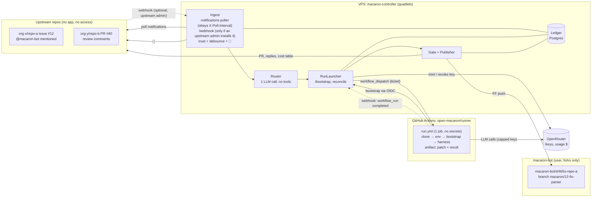
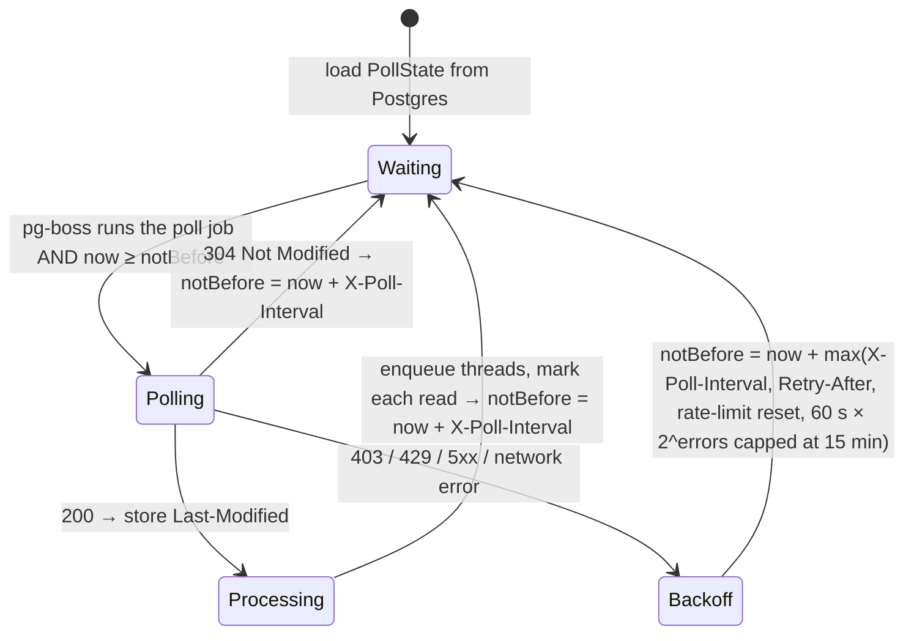
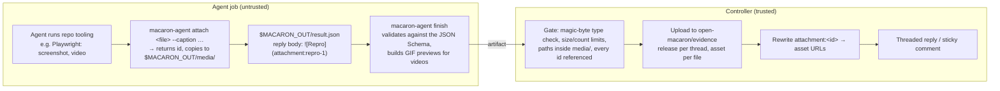

# macaron-bot — design draft

Companion docs:
- [SCALING.md](SCALING.md): environments (shared/own/upstream), config hierarchy, limits;
- [REPOSITORIES.md](REPOSITORIES.md): the `open-macaron` org, its repos, accounts, tokens and onboarding;
- [ENGINEERING.md](ENGINEERING.md): stack, code layout, quality gates;
- [DEPLOYMENT.md](DEPLOYMENT.md): supply chain, Fedora VPS with Podman quadlets.

## 1. Why

- ~30 upstream repos across many orgs; we can't install GitHub Apps there, and `macaron-bot` **never has any access to them**: no collaborator role, no org membership. It acts exactly like an outside contributor, working from forks (see "Operating as an outside contributor").
- We want a bot account (`macaron-bot`) that is mentioned on an issue and then plans, asks questions, or opens a PR. It also handles review loops on its own PRs.
- Agents (claude / codex / opencode) run on GitHub-hosted runners, so we don't manage agent environments.
- A **controller on our Fedora VPS** (rootless Podman quadlets) holds every credential and does everything deterministic: polling, webhooks, reactions, budget keys, policy checks, pushes, comments.
- Security comes first. The agent never holds a GitHub credential. Every agent run gets its own budget-capped OpenRouter key. Pushes are done afterwards by deterministic code that only writes to one branch.
- The bot only works for allow-listed repos and users. It reacts fast (👀), comments little, reports the cost of every action, and learns over time through a curated knowledge base.

## 2. Target architecture



**Event sources.**
- *Notifications* are the only signal we get from the upstream repos. We act on three reasons:
  - `mention`: the trigger, §8.4;
  - `author`: reviews and comments on the bot's own PRs;
  - `comment`: follow-ups on threads the bot has already replied in.

  `review_requested` can't happen, because a reviewer must have access. `assign` only happens if a maintainer assigns the bot after it has commented on that issue; it's treated like a bare mention. The controller polls notifications with conditional GETs (§4).
- *Webhooks* are instant. They work for upstream repos whose admins opt in, and for **our own org**, `open-macaron`: a webhook on the `runner` repository delivers `workflow_run` events from `runner`, which tell the controller that an agent finished. We own the org, so this always works.

**Why a controller of our own.** GitHub holds **no secrets at all**. The prepare, gate and publish jobs leave Actions, which saves about 20–40 s of runner start-up per job and is a real speed gain. The controller can also revoke a key mid-run.

## 3. Trust boundaries

On GitHub-hosted runners, any secret a job references can be read by every step of that job, because steps run with sudo and can read the runner process's memory. With this design, the agent job references none.

```mermaid
sequenceDiagram
  box rgb(230,245,230) VPS controller (trusted, all secrets)
    participant C as Controller
  end
  participant OR as OpenRouter
  box rgb(250,230,230) GitHub Actions job: agent (permissions: id-token write only)
    participant J as run.yml
  end

  Note over C: launch(thread, mode)
  C->>C: trust + ledger caps (refuse → 😕 + reply)
  C->>OR: POST /keys {limit}
  OR-->>C: key → stored under ticket with context
  C->>J: workflow_dispatch {ticket, repo, baseSha, branch, env, runs-on}
  J->>J: clone upstream@baseSha + fork branch (anonymous)
  J->>J: env: composite from shared | own | upstream (SCALING.md §1)
  J->>C: POST /bootstrap {ticket, OIDC token aud=macaron}
  C->>C: verify OIDC claims, redeem ticket ONCE, bind run_id
  C-->>J: key + context (key masked, harness env only)
  Note over J: harness runs — UNTRUSTED from here on
  J->>OR: LLM calls with the capped key
  loop watchdog
    C->>OR: live usage, wall-clock → abort revokes the key
  end
  J->>J: upload artifact: changes.patch + result.json
  J-->>C: webhook: workflow_run completed
  C->>OR: disable key now (spending stops); settle-cost job ~90 s later: final usage → ledger → delete key
  C->>C: download artifact → Gate (policy)
  Note over C: Publisher: commit, FF push, replies, cost table, 👀 → 👍/😕
```

- The OIDC check requires `repository_id` and `repository_owner_id` (immutable), of `open-macaron/runner`, `workflow_ref=open-macaron/runner/.github/workflows/run.yml@refs/heads/main`, `event_name=workflow_dispatch` and `actor=macaron-bot`.
- A ticket can be redeemed only once. The legitimate bootstrap step uses it before the agent starts, so an agent that mints its own OIDC token gets nothing. The environment step runs *before* bootstrap. If environment code redeems the ticket first, the real bootstrap gets a 409 and the controller revokes the key at once: at worst a failed run, never a leaked credential.
- The agent job has no endpoint for submitting results. The controller *pulls* the artifact.

## 4. Components (`packages/controller/`, NestJS — module map in ENGINEERING.md §3)

```ts
class Ingest {
  constructor(gh: GitHubClient, trust: TrustList, ledger: Ledger, router: Router, poller: NotificationsPoller) {}
  /** POST /webhook — only for upstream repos whose admins install our webhook (HMAC-verified). Not assumed. */
  onUpstreamWebhook(ev: WebhookEvent): Promise<void>;
  /** 👀 immediately; hand the thread to the Router once it has been quiet for 60 s (one review = one run). */
  schedule(ev: TriggerEvent): Promise<void>;
}

/** The only code allowed to call GET /notifications. Runs as a pg-boss job: one active across instances. */
class NotificationsPoller {
  constructor(source: NotificationsApi, state: PollStateStore, sink: NotificationSink, scheduler: PollScheduler, clock: Clock) {}
  /** Polls only if now ≥ state.notBefore (otherwise reschedules), persists the new state, schedules the next poll. */
  tick(): Promise<NotificationThread[]>;
}

interface PollState {            // one row in Postgres, survives restarts and deploys
  lastModified: string | null;   // sent back as If-Modified-Since
  intervalSec: number;           // last X-Poll-Interval seen (floor 60)
  notBefore: Date;               // earliest moment the next poll is allowed
  consecutiveErrors: number;
}

class Router {
  /** One tool-less LLM call on the thread text: "thanks!" → noop, question → triage, changes → address_review. */
  route(thread: ThreadSnapshot): Promise<{ mode: Mode | "noop"; reason: string; costUsd: number }>;
}

class RunLauncher {
  constructor(gh: GitHubClient, budgets: BudgetService, ledger: Ledger, publisher: Publisher) {}
  /** Caps check → mint key → store ticket → workflow_dispatch(run.yml, { ticket, repo, baseSha, branch, env, runsOn }). */
  launch(thread: ThreadRef, mode: Mode): Promise<Ticket>;
  /** POST /bootstrap — verify OIDC, redeem ticket once, bind run_id. */
  bootstrap(oidc: string, ticket: string): Promise<BootstrapPayload>;
  /** workflow_run completed → settle key, fetch artifact, Gate, Publisher; escalate if asked. */
  complete(run: WorkflowRun): Promise<void>;
  /** /stop, budget watchdog, or timeout → disable key now, cancel the run. */
  abort(ticket: string, reason: string): Promise<void>;
  /** Every 2 min: runs still pending in the ledger are checked via the API, so a webhook missed during a restart is never lost. */
  reconcile(): Promise<void>;
}

interface BootstrapPayload {
  orKey: string; context: RunContext;
  clone: { upstream: string; baseSha: string; fork: string; branch: string };
}
```

Behaviour notes:
- The Router has a controller-owned OpenRouter key with `limit_reset: daily`, and its cost is recorded in the ledger. A "thanks!" therefore costs about $0.001 and never starts a runner.
- Run modes:
  - `triage`: read-only, no setup step, small budget. It answers questions in a thread.
  - `plan`, `implement`, `address_review`: full environment.
  - `reproduce` (on the base commit) and `verify` (on the PR branch): full environment, **no commit**. They reply with evidence such as screenshots and videos (see "Evidence" below). `@macaron-bot can you reproduce?` routes here.
  - A run may return `escalate`, in which case `complete()` launches the next run in the requested mode.
  - Explicit commands (`@macaron-bot implement`, `/plan`, `/stop`) skip the Router.
  - `@macaron-bot retry` runs the thread's last failed or stopped loop again, with the same mode and trigger. It is refused when the last loop succeeded. Each failure's status comment says so.
- The Ingest drops events from untrusted repos, untrusted users, and the bot itself. It also caps loops: at most N review loops per PR, and a lower cap when the reviewer is a bot, so two bots can't ping-pong forever.
- Review *summaries* don't support reactions, so 👀 goes on their first inline comment, or on the PR otherwise.

### Notification polling rules

GitHub's documentation: *"There is an `X-Poll-Interval` header that specifies how often (in seconds) you are allowed to poll. In times of high server load, the time may increase. Please obey the header."* We treat it as a hard contract:



1. **The header always wins.** Every response (200, 304, error) updates `intervalSec` from `X-Poll-Interval`. If it is missing, the last known value is kept, and never less than 60 s. The poller has no "poll now" path: no deploy, webhook, command or admin endpoint can trigger an early poll.
2. **`notBefore` is persisted before the next sleep.** A restart, a crash loop or a deploy every five minutes can never cause an extra request.
3. **Exactly one poller.** A second controller instance would double the rate. The poll is a pg-boss job on a `stately` queue with one key, so at most one runs at a time across instances. It reschedules itself for exactly `notBefore`; a once-a-minute cron entry only guarantees a poll stays pending, and a job that wakes early makes no request.
4. **Conditional requests.** `If-Modified-Since` carries the stored `Last-Modified`, so a 304 costs no rate limit.
5. **One poll is one logical request.** We use `participating=true` (only direct involvement: `mention`, `author`, `comment`, rarely `assign`). We mark threads as read after enqueueing (`PATCH /notifications/threads/{id}`), and auto-watch is off on the bot account, so a poll fits in one page (`per_page=50`). If `Link: next` appears, the remaining pages are fetched within the same poll. A warning metric fires, because it means the inbox isn't being drained.
6. **Errors back off, they never retry fast.** The wait is `Retry-After`, the rate-limit reset, or an exponential backoff, whichever is longest, and never shorter than the poll interval.
7. **Pinned API version.** All Octokit clients send `X-GitHub-Api-Version: 2026-03-10`. These endpoints only accept a classic PAT with the `notifications` scope, which is `GH_INTERACT`.

Latency is therefore *at least* one poll interval (typically ~60 s, more when GitHub is under load). When an upstream repo installs our webhook, it is the fast path; polling remains the floor.

### Budgets (`BudgetModule`)

```ts
class BudgetService {
  /** POST /keys in the `macaron` workspace: capped at limitUsd, expiring by itself after ttlMinutes. */
  mint(runId: string, limitUsd: number, ttlMinutes: number): Promise<ProvisionedKey>;
  /** Disable now: spending stops at the next request. Called when a run completes or is aborted. */
  freeze(hash: string): Promise<void>;
  /** Final usage (two agreeing reads), then DELETE. Run by the settle-cost job ~90 s after the run. */
  finalUsage(hash: string, signal: AbortSignal): Promise<UsdMicros>;
  /** Live usage, for the watchdog. */
  usage(hash: string): Promise<UsdMicros>;
}
```

- **All keys live in one OpenRouter workspace** (`OPENROUTER_WORKSPACE`, default `macaron`). The controller resolves it at startup and refuses to start if it's missing. The workspace dashboard is therefore the bot's total spend, and a workspace budget can act as a hard global ceiling on top of our caps.
- **Costs are settled in two phases.** OpenRouter reports a key's usage asynchronously (measured: ~25 s after the call). At completion the key is frozen and the result is published immediately. A `settle-cost` job runs ~90 s later, writes the final cost to the ledger once, deletes the key and refreshes the PR's cost table, where the loop shows "settling…" until then. A run's whole limit counts against the caps until it is settled, so nothing can overshoot in between.

- Caps exist at four levels: per-run key limit, per thread, per repo per month, and global concurrency. There is also a kill switch (`MACARON_ENABLED`).
- Every run key expires on its own (`expires_at` = timeout + 15 min). A `sweep-keys` pg-boss cron job deletes leftovers, as a safety net.
- The last request can overshoot a key's limit a little, so harness `max_tokens` stays bounded.

### Gate and Publisher (`PublishModule`)

```ts
class Gate {
  /** Rejects: .github/** changes, secrets (gitleaks), binaries, > N files/lines, a mode/action mismatch (triage can't commit). */
  check(mode: Mode, patch: Patch, result: RunResult): Verdict;
}

class Publisher {
  /** One commit per loop, bot author, signed; FF-only push to the ledger-owned branch (never one named by the agent). */
  pushLoop(thread: ThreadRef, patch: Patch, message: string): Promise<string>;
  /** Threaded replies first, then edit the sticky status comment, then at most 1 top-level comment. */
  respond(thread: ThreadRef, result: RunResult): Promise<void>;
  /** Rewrite the <!-- macaron:cost --> section of the PR body from the ledger. */
  renderCostTable(pr: PullRef): Promise<void>;
}
```

The controller has three GitHub tokens, all stored as Podman secrets. Exact scopes and why each is shaped that way are in REPOSITORIES.md §3:

| Token | Type | Can do |
|---|---|---|
| `GH_PUSH` | fine-grained PAT, owner macaron-bot | Contents write on its repos, which are only forks; no Workflows permission |
| `GH_INTERACT` | classic `public_repo` PAT | Comments, reactions, PRs, notifications on upstream repos; blocked from `open-macaron` by org policy |
| `GH_ORG` | fine-grained PAT, owner open-macaron | `runner` only: Actions write (start and cancel runs) |

### Harness contract (`harness/<name>/run.sh`, `packages/contracts`)

For Claude Code the adapter sets `ANTHROPIC_BASE_URL=https://openrouter.ai/api`, `ANTHROPIC_AUTH_TOKEN=<orKey>` and `ANTHROPIC_API_KEY=""`.

```ts
type Mode = "triage" | "plan" | "implement" | "address_review" | "reproduce" | "verify" | "retro";

interface RunContext {
  mode: Mode; repo: string; number: number; branch: string; baseSha: string;
  trigger: { kind: "assign" | "mention" | "review" | "comment"; url: string };
  thread: Comment[]; reviewComments: ReviewComment[];   // untrusted text; IDs are kept for replies
  priorLoops: LoopSummary[]; knowledge: KnowledgeSlice;
}

interface RunResult {
  action: "reply" | "plan" | "ask" | "commit" | "escalate" | "noop";
  escalateTo?: Mode; commitMessage?: string; prTitle?: string; prBody?: string;
  replies: { inReplyTo: number; body: string }[];        // bodies may embed 
  summary: string;
  attachments: { id: string; path: string; kind: "image" | "video"; caption: string; preview?: string }[];
  learnings: { scope: "global" | "repo"; topic: string; text: string; evidence: string }[];
}
```

`config/` lives in `open-macaron/macaron`. Changes need CODEOWNERS review; `deploy.sh` delivers them to the VPS and signals a reload. It holds, per global/project/repo level, the users and bots allowed to trigger, harness and model, environment, budgets and caps (SCALING.md §2).

### Environments and configuration

There is one workflow, `open-macaron/runner/.github/workflows/run.yml`. Each repo's environment is a **composite action** that `run.yml` loads at runtime from one of three sources:
- **shared:** a family environment with parameters, for example all Podman Desktop extensions;
- **own:** a folder in `runner` owned by the repo's team;
- **upstream:** shipped in the upstream repo and read at the base SHA, for example Podman Desktop itself.

Configuration is a hierarchy, `config/global.yaml` → `projects/<p>/project.yaml` → `projects/<p>/repos/<r>.yaml`. The project is the unit for budget, trusted users and ownership. The full reasoning, examples and scaling limits are in [SCALING.md](SCALING.md).

### Evidence: screenshots and videos

**We never produce media ourselves; the repo's own tooling does.** For Podman Desktop, that means its Playwright setup: its environment provides Xvfb and Podman, and its `AGENTS.md` or knowledge explains how to launch the app and record. Our side defines only **where the agent drops files, how it references them, and what we do with them**.



- **The agent never writes the JSON by hand.** `macaron-agent` (agent-cli) gives it commands: `attach`, `reply`, `ask`, `finish`. They produce a valid `result.json`, and `finish` fails with a readable error the agent can fix within the same run.
- **Rendering on GitHub:**
  - images are embedded inline;
  - GitHub only plays videos uploaded through its own UI, which has no API. So a video is posted as its GIF preview, linked to the full `.webm`/`.mp4` release asset.
- **Hosting** is GitHub Releases in a dedicated public repo, `open-macaron/evidence`: one release per thread (tag `t/org-x.repo-a.12`), one asset per file. That gives no git-history bloat and up to 2 GB per file. Releases of closed threads are pruned after 180 days.
- **Limits:**
  - allowed types: png, jpeg, webp, gif, webm, mp4;
  - at most 10 files and 50 MB per run.

  The controller only checks magic bytes and sizes. It never decodes or transcodes media, so it doesn't parse untrusted files.
- **Capability-gated.** A repo's config declares `capabilities: [gui, video]`, and env-check proves them nightly. Without them, the Router doesn't pick `reproduce`/`verify`; the bot answers that the environment can't run the app yet.

### Operating as an outside contributor

With no access, the bot can do anything a stranger can do on a public repo and nothing more. Here is what it can rely on and what it has to handle:

| Can do (no access needed) | Can't do | How we handle it |
|---|---|---|
| Comment, reply to review threads, react | Label, assign, request reviewers, set milestones | Status lives in the sticky comment. Maintainers triage as they would for any contributor |
| Open PRs from its fork, edit its own PR title/body, mark draft → ready, close its own PR | Push to upstream branches, merge | Cost table and status in the PR body; humans merge |
| Read everything public (code, issues, checks, logs) | **Run upstream CI on its PRs without approval**: fork PRs from outside contributors often need a maintainer to click "Approve and run" | The agent runs build and tests in *our* runner before publishing. The sticky comment says "upstream CI awaiting maintainer approval". The controller reads the public check runs on the head SHA and can offer a `fix-ci` loop. That loop is off by default and enabled per repo in config |
| — | Comment on **locked** conversations or repos with **interaction limits** | Publisher treats 403/422 as "can't post here". It records this in the ledger, revokes nothing, and doesn't retry. The run's cost still lands in the ledger |
| — | Bypass contribution requirements | Per-repo config `contribution: { dco: true }` makes the Publisher add `Signed-off-by: macaron-bot <…>` to each commit (Podman Desktop requires DCO). A CLA is signed once per upstream org by a maintainer for the bot account, as part of onboarding |

**Later: if the bot gets minimal access.** We start without access, but nothing in the design prevents adding it per upstream org. With read-only org membership or a triage role:
- the `assign` and `review_requested` notification reasons become first-class triggers;
- labels (`macaron:plan`, `macaron:stop`) become possible.

Each trigger maps to the same `TriggerEvent`, so it only touches `Ingest`. Config gains `access: none | read | triage` per repo, and the controller uses the extra triggers only where config says the access exists. The security model doesn't change: tokens stay on the VPS, and the agent still has none.

Mentions from untrusted users are ignored silently: no reaction, no reply, no LLM call. That avoids spam and doesn't advertise the bot. Follow-up comments on threads the bot is in arrive as `comment` notifications and go through the same trusted-user filter before the Router sees them.

## 5. Review loop and reporting

```mermaid
sequenceDiagram
  Reviewer->>Upstream PR: review (3 inline comments)
  Controller->>Upstream PR: 👀 (next allowed poll, per X-Poll-Interval; instant if webhook)
  Controller->>Controller: 60 s quiet → Router: "2 change requests, 1 question"
  Controller->>Actions: dispatch run.yml {ticket} mode=address_review
  Actions->>Controller: bootstrap (OIDC) → key + context
  Actions-->>Controller: workflow_run completed (webhook)
  Controller->>Fork branch: FF push "address review #2"
  Controller->>Upstream PR: threaded replies, cost table row 2, 👀 → 👍
```

Comment discipline:
1. Threaded replies to review comments first.
2. Then one sticky status comment per issue/PR, which the bot edits instead of re-posting.
3. A new top-level comment only when asking the human something, and at most one per run.

The PR body ends with a section that the Publisher regenerates from the ledger on every loop:

```md
<!-- macaron:cost:start -->
| Loop | Trigger | Mode | Model | Cost | Run |
|---|---|---|---|---|---|
| 1 | #12 mention by @alice | implement | sonnet-5.5 | $1.84 | [run](…) |
| 2 | review by @alice | address_review | sonnet-5.5 | $0.62 | [run](…) |
| 3 | question by @bob | triage | haiku-5.5 | $0.03 | [run](…) |
| – | 4 routed comments | router | haiku-5.5 | $0.004 | |
| **Total** | | | | **$2.49** | |
<!-- macaron:cost:end -->
```

## 6. Knowledge and rules (`open-macaron/knowledge`)

The knowledge repository holds two kinds of content, with different authors and uses:

| | **Rules** | **Lessons** |
|---|---|---|
| What | What changed code must look like ("use Svelte 5 runes") | Facts learned ("e2e tests need `xvfb-run`", "reviewers prefer small PRs") |
| Written by | Humans (the folder's owners) | The bot proposes, the folder's owners approve |
| Used for | Implementing, and the per-rule review (§6.3) | Context for the agent |
| Loaded | Only rules whose globs match the files in play | Through the index; the agent opens a lesson when it needs it |
| Identity | Stable id (`sandbox/no-runtime-json-read`), cited by review tables; never reused | File name |

A lesson becomes a rule only when a human promotes it: the bot never writes rules, because the reviewer enforces them. Nothing is read from upstream repositories for now (beyond the harness loading their `AGENTS.md` / `CLAUDE.md` natively).

### 6.1 Layout

```
knowledge/
├── README.md                    how to write rules and lessons
├── .github/workflows/           check.yml, review.yml, merge.yml, pages.yml (platform team only)
├── global/
│   ├── OWNERS.yaml              the platform team
│   ├── rules/<slug>.md          every repo (commit messages, PR etiquette)
│   └── lessons/<topic>.md       working with macaron, harness tips
├── projects/<project>/          same names as macaron's config/projects/<project>
│   ├── OWNERS.yaml
│   ├── rules/<slug>.md
│   └── lessons/<topic>.md
└── repos/<owner>/<repo>/        the upstream slug, not the fork
    ├── OWNERS.yaml
    ├── overview.md              layout, build/test quirks; always inlined in the prompt
    ├── rules/<slug>.md
    └── lessons/<topic>.md
```

A rule's scope comes from its folder, never from a field its author picks: rules in `projects/a/` only reach project `a`'s repositories. A rule's id is `<scope>/<slug>`, where `<scope>` is `global`, the project name or `<owner>/<repo>`, and `<slug>` is its file name. The index is generated from front matter, never committed.

`OWNERS.yaml` is our format; GitHub doesn't read it, and there is no `CODEOWNERS` for these folders (§6.4). Owners are matched by **numeric user id**: a login can be renamed and re-registered. The login is there for display and mentions; `check.yml` verifies that it still resolves to the id.

```yaml
owners:
  - login: axel7083
    id: 42176370
```

### 6.2 Rule format

Rules are written to be checked one at a time by a cheap model: one checkable thing per rule, with a narrow yes/no question and examples. The schema (`@open-macaron/contracts`) and `check.yml` enforce the front matter and the four sections.

````markdown
---
title: Import package.json instead of reading it at runtime
severity: error                  # error → ❌ violation, warning → ⚠️ warning
applies_to: ["src/**/*.ts"]      # globs; files and directories alike. Omitted = every file.
exclude: ["**/*.spec.ts"]
sources:                         # where the rule comes from: review comments, docs
  - https://github.com/axel7083/foobar-tmp-demo/pull/2#discussion_r4285183794
---
## Check
Does the changed code read `package.json` from disk at runtime?

## Violation
An added or modified line that reads `package.json` with `fs` (`readFile`, `readFileSync`, `require` of a computed path).

## Not a violation
Tests and build scripts; `import pkg from '../package.json'`.

## Examples
```ts
// ✅
import pkg from '../package.json';
// ❌
const pkg = JSON.parse(await readFile(join(root, 'package.json'), 'utf8'));
```
````

Lessons carry `topic`, optional `applies_to`, `sources`, `last_verified` and `confidence`.

### 6.3 Using rules

- **Selection is deterministic.** The controller merges global → project → repo and keeps the rules whose `applies_to` / `exclude` match the files in play: the PR's diff for a review, the bot's own diff before publishing. For `implement` the files aren't known in advance: the prompt carries the rule index (id, title, globs), and the agent reads the full rules for what it touches.
- **A review is a run** (`@macaron-bot review`, mode `review`), on the same path as `implement`: capped key (`budgets.review`), OIDC bootstrap, `run.yml`, artifact, Gate, settlement, `retry` and `stop`. The model is `models.review` (a cheap one). `full-environment` is off: on a pull request anyone can open, the environment step would run that pull request's code.
- **One harness session, read-only, with a good prompt** rather than our own loop over rules (models improve; scaffolding doesn't). The session gets every selected rule with the files it matches, and the diff annotated with line numbers; it can read files, search, and run `git log` / `blame` / `show` / `diff`, and nothing else (`--tools`, `--permission-mode dontAsk`). Past 5 rules the prompt asks for one subagent per rule, which keeps each rule's context short. The answer is schema-bound (`--json-schema`): `{ verdicts: [{ ruleId, verdict: pass | violation | not_applicable, evidence: [{ file, line, quote }], explanation }] }`. One session per rule stays possible inside agent-cli if the evaluation (#4) calls for it.
- **What stays deterministic:** selection by globs (no rule matched → no run), coverage (a rule without a verdict shows as "not checked"), and evidence. A `violation` stands only if each quote it keeps is on a line the pull request adds, at that number, in a file the rule applies to, as read from GitHub by the controller at the reviewed commit; otherwise the rule is reported as ignored (unverified). This catches the cheap model's main failure: inventing violations. A compromised reviewer can't accuse a contributor; at worst it can wrongly pass a rule.
- **Output:** one GitHub review (COMMENT, never approve or request changes) on the reviewed commit: the table, explanations in a collapsed section, an inline comment per verified violation, and the cost (⏳ until settled).
- **The table at the end of the review:**

  | Rule | Severity | Result | Evidence |
  |---|---|---|---|
  | `sandbox/no-runtime-json-read` | error | ❌ violation | [`src/extension.ts:12`](…) `readFile(…package.json…)` |
  | `global/conventional-commits` | warning | ⚠️ warning | commit `8c694b4`: no type prefix |
  | `sandbox/escape-webview-html` | error | ✅ valid | |
  | `sandbox/i18n-strings` | warning | ➖ ignored | no matching file changed |

- **The bot reviews its own diff before publishing:** a ❌ sends the agent back to fix it.

### 6.4 Approval and merge, entirely in GitHub (Prow-style)

Folder owners need **no write access and no org membership**: their approval is checked by a workflow, not by GitHub's branch protection. Only the platform team has write access. The repository's own `GITHUB_TOKEN` merges; there is no extra token or service.

```
PR from a fork
 ├─ check.yml   on: pull_request          permissions: {}   format feedback for the author; never trusted
 ├─ review.yml  on: pull_request_review   permissions: {}   no-op; exists to emit workflow_run
 └─ merge.yml   on: workflow_run [review, check] completed  — always the version on main
      concurrency: merge (one run, bursts collapse)
      job find      pull-requests: read   open PRs whose head is workflow_run.head_sha
      job validate  contents: read    PR content checked out as data (allow-unsafe-pr-checkout: no secrets,
                                      no cache, nothing executed); knowledge-cli pinned by sha256
      job merge     contents: write, pull-requests: write — API only, no PR checkout
      job pages     calls pages.yml (a GITHUB_TOKEN merge triggers no push workflow)
```

**`review.yml` and `check.yml` are attacker-controlled.** For a fork PR, GitHub runs the PR's version of them, and `workflow_run` matches workflows by name, so a PR can trigger `merge.yml` at will with a run that ends however it likes. So `merge.yml`:

- takes only `workflow_run.head_sha` from the event, to find which PR to evaluate: open PRs whose `head.sha` equals it (compared as data, passed through `env:`, never interpolated in `run:`). No match → nothing to do. It reads no artifact, output or conclusion from the triggering run, and never the branch name;
- never treats the trigger as "ready to merge". For each matched PR it re-derives everything from GitHub data:
  1. **Approvals:** each reviewer's latest review; it counts if it is `APPROVED`, on the current head sha (`commit_id`), and its author's **id** is in the matching `OWNERS.yaml` **on `main`**. The PR author's approval never counts.
  2. **Coverage:** every touched file is under `global/`, `projects/<p>/` or `repos/<o>/<r>/` whose `OWNERS.yaml` exists on `main`, and each such folder has a valid approval. Anything else (`.github/`, root files, a new folder) is merged by the platform team by hand. Changes to an `OWNERS.yaml` follow the same rule: the current owners approve.
  3. **Format:** the validate job's verdict, computed with the CLI pinned on `main`.
  4. **Merge** with `sha = <the head checked above>`, so a push in between makes GitHub refuse.
- keeps one status comment on the PR saying what is missing ("waiting for an owner of `projects/sandbox/`: @axel7083"); GitHub only allows review requests to collaborators.

The worst an attacker can do with the triggers is make `merge.yml` evaluate a PR (theirs or another with the same commit) more often: the evaluation is complete, and `concurrency` bounds the cost.

The `main` ruleset requires a PR and blocks force pushes; it requires no native approval (owners' approvals don't count for GitHub) and no status check (a fork can fake a check name). Branch creation is restricted: everyone works from forks. Verified live on 2026-10-15:

- **Dismiss stale approvals on push** is on: a push that changes what the PR proposes turns approvals into `DISMISSED` (#4), which `merge` never counts. A push that only brings in `main` (*Update branch*) keeps them, and GitHub moves their `commit_id` to the new head (#1). So `commit_id` alone doesn't prove "approved this exact commit"; the dismissal does the work for content changes.
- `require_extra_approval_for_unattributed_changes`, which GitHub enables by default on new rulesets, is set to `false`: it demands a native approval, which owners can't give.
- **No workflow token can merge a branch that is behind `main` on `.github/workflows/`** (HTTP 403, "Resource not accessible by integration"); a PAT without the `workflow` scope can't update such a branch either. `merge` reports these PRs as outdated, and the bot recreates its branches from upstream `main` instead of updating them.

### 6.5 Read API on GitHub Pages

`pages.yml` builds static JSON with the same `knowledge-cli` and publishes it:

```
https://open-macaron.github.io/knowledge/v1/
├── index.json                   commit sha; every folder's rules (id, title, severity, globs) and lessons
├── global.json
├── projects/<project>.json
└── repos/<owner>/<repo>.json    each: the folder's overview, rules and lessons, full text
```

One file per folder, not pre-merged: which project a repository belongs to is macaron's configuration, not the knowledge repository's. The controller fetches `global`, the repo's project and the repo (ETag-cached, versioned by commit) and merges them, instead of cloning. Everything is public already; anyone can see what the bot enforces on a repository. Shapes: `KnowledgeIndex` and `KnowledgeSlice` in `@open-macaron/contracts`.

### 6.6 Gathering lessons

- **Gather:** every run emits `learnings[]`, each with evidence such as a review comment URL. A `retro` run starts when a PR is merged or closed and extracts lessons from the full review thread; reviewer corrections are the highest-signal input. Trusted users can also write `@macaron-bot remember: …`.
- **Propose:** agent output is untrusted, and a poisoned knowledge base would be a persistent attack, so learnings are never written directly. The Publisher appends them to a PR from `macaron-bot/knowledge` per folder, and that folder's owners approve it (§6.4). A weekly `garden` run proposes dedupes, prunes stale lessons and suggests promotions to rules, in the same PRs.

## 7. Security invariants

| Threat | Mitigation |
|---|---|
| Agent steals a GitHub token | There are no GitHub-side secrets; the job only has `id-token: write`, and its ticket is already redeemed |
| Agent pushes elsewhere or rewrites history | Only the controller pushes: one ledger-owned ref, fast-forward only; `GH_PUSH` is limited to the forks, without workflows permission |
| Runaway spend | Per-run key limit, live watchdog, mid-run revoke, thread/repo/month caps, loop caps, `timeout-minutes`, kill switch |
| Prompt injection via issue or review | Worst case is a bad patch in a PR that humans review; replies are sanitised (capped, @mentions defanged); knowledge updates are gated |
| Malicious media (huge files, disguised types, HTML/SVG) | Allow-list by magic bytes (no SVG or HTML), size and count caps, served from GitHub Releases rather than our host; the controller never decodes media |
| Forged authorship | The Publisher creates the commit itself (bot author, signed) from the diff |
| Fork CI with our pushes | Actions disabled on every fork at onboarding |
| Forged webhooks or bootstrap calls | HMAC on webhooks; OIDC signature and claims checked on bootstrap; the reverse proxy only exposes `/webhook` and `/bootstrap` |

Self-hosted runners on the VPS are deliberately not used. The machine holding every credential must never run agent code; throwaway GitHub VMs isolate it for free.

### Everything is public

All `open-macaron` repos, the `runner` Actions logs, the images and the knowledge base are public. Consequences:

- **Upstream repos must be public.** The config schema rejects private repos, because agent transcripts appear in public run logs. This also keeps `GH_INTERACT` at `public_repo` scope.
- **The OIDC check uses immutable ids** (`repository_id`, `repository_owner_id`), not names. Anyone can fork `runner` and run its workflows in their fork, but their token carries another `repository_id` and is rejected. Manually dispatched runs without a ticket fail at bootstrap.
- **Workflow hygiene:**
  - no `pull_request_target` and no `workflow_run` triggers on untrusted input;
  - top-level `permissions: {}`;
  - actions pinned by SHA;
  - `zizmor` in CI (see ENGINEERING.md §8).
- **Sensitive values stay out of logs.** `orKey` is masked as the job's first step, and harness adapters never echo their environment. The knowledge base must not contain anything non-public about upstream projects or people.

## 8. Decisions

1. **Ingress (decided).** Caddy on the VPS terminates TLS and exposes only `/webhook` and `/bootstrap`.
2. **Ledger storage (decided).** PostgreSQL in the controller's pod on the VPS, with Drizzle ORM. See DEPLOYMENT.md §2.
3. **Stack (decided).** NestJS 12 (ESM), TypeScript 6 strict, Drizzle v1 via `@nestjs/drizzle`, Zod, Vitest. See ENGINEERING.md.
4. **Triggers (decided).** The trigger is a **mention**: `@macaron-bot [plan|implement|reproduce|verify|stop|retry|…]` from a trusted user. The bot never gets access to upstream repos, so no trigger is built on assignment, review requests or labels. GitHub lets a maintainer assign the bot only after it has commented on that issue; that rare case is handled like a bare mention, with the assigner checked against the trusted users.
5. **Private upstreams (decided: no).** Public only, see "Everything is public".
6. **Hosting (decided 2026-10-15):** a Fedora VPS running rootless Podman quadlets, replacing OpenShift. Still open: see DEPLOYMENT.md §6.
7. **Organisation (decided 2026-10-15):** `open-macaron` owns `macaron`, `runner`, `knowledge` and `.github`; the user `macaron-bot` owns only forks. See REPOSITORIES.md.
8. **Knowledge approval (decided 2026-10-15):** Prow-style. Per-folder `OWNERS.yaml` matched by user id; folder owners need no write access; `merge.yml` (on `main`, triggered by reviews, trusting nothing from the triggering run) merges with the repository's own token. No upstream-provided rules for now. See §6.4.

## 9. Milestones

0. Org bootstrap: REPOSITORIES.md §6.
1. Controller skeleton on the VPS: ledger, `BudgetService`, `RunLauncher` with manual launch, `/bootstrap` with OIDC, `workflow_run` webhook, Gate and Publisher. Claude harness, implement mode, one sandbox repo.
2. Notifications ingest, 👀, debounce, Router, triage mode, threaded replies, sticky comment, cost table.
3. Caps, watchdog, `/stop`, loop caps, key sweeper.
4. Knowledge: consult, then gather → knowledge PR, then retro/garden.
5. codex and opencode adapters; upstream webhooks where an upstream admin offers one.
6. `reproduce` / `verify` with evidence: `macaron-agent attach`, Gate media checks, `evidence` releases, GIF previews. Pilot: Podman Desktop with Playwright.

## 10. Verification

- **Red-team the agent job:** prompt the agent to dump env vars, `/proc`, and `Runner.Worker` memory, to `git push`, and to mint an OIDC token and call `/bootstrap` again. Expected: it only finds `orKey`, and the second bootstrap returns 409.
- **Budget:** set the limit to $0.05 on an implement run. The watchdog must abort it, the cost must land in the ledger, and the thread must show 😕 plus a short reply.
- **Policy:** a patch touching `.github/workflows/`, or containing a fake AWS key, must be rejected by the Gate.
- **End to end:** `@macaron-bot implement` on a sandbox issue → 👀 → PR opened → inline review → Router → threaded replies + cost table row 2 → merge → knowledge PR updated.
