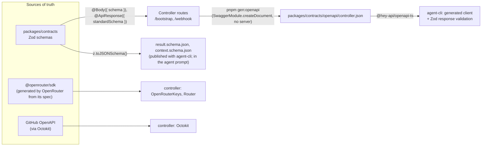

# macaron-bot — engineering guidelines

How the controller and the agent-side CLI are built. The system design is in [DESIGN.md](DESIGN.md); deployment and the supply chain are in [DEPLOYMENT.md](DEPLOYMENT.md).

## 1. Stack

| Concern | Choice | Notes |
|---|---|---|
| Runtime | Node.js 24 LTS | Same major in the container (`ubi10/nodejs-24-minimal`) and in CI |
| Framework | NestJS 12, **ESM** | All Nest packages ship as ESM |
| Language | TypeScript 6.0 | The version `nest upgrade` targets. TS 7 (`tsgo`) can be added as a faster `--noEmit` check once Nest's CLI supports it |
| Database | PostgreSQL 17 (container in the controller's pod), **Drizzle ORM v1** + `@nestjs/drizzle` + `pg` | Drizzle 1.0 is still `rc`, as used by the Nest docs. Pin the exact version and move to GA when it ships |
| Validation | Zod 4, through **Nest 12's native Standard Schema support** | `@Body({ schema })` + `StandardSchemaValidationPipe` validate requests; `@nestjs/swagger` 12 builds OpenAPI from the same schemas (`@ApiResponse({ standardSchema })`). There is no `@nestjs/zod` package, and `nestjs-zod` v5 only supports Nest ≤ 11, so we use no third-party bridge. Zod also validates every non-HTTP input: env, webhooks, notifications, OIDC claims, `config/**`, `result.json` |
| GitHub | `@octokit/rest` + `plugin-throttling` + `plugin-retry`, `@octokit/webhooks-methods` | Octokit is generated from GitHub's own OpenAPI spec. One client per token, see §4 |
| HTTP clients | Official SDKs first, otherwise `@hey-api/openapi-ts` | Every client is **generated from an OpenAPI spec**, never handwritten (§5). OpenRouter: `@openrouter/sdk`, which OpenRouter generates from its own spec (standalone functions, Zod-validated responses, typed `Result` errors) |
| OIDC | `jose` | JWKS from `token.actions.githubusercontent.com`, cached |
| Infra libs | `nestjs-pino` (JSON logs, secrets redacted), `@nestjs/terminus` (probes), `nestjs-cls` (request/run correlation id) | |
| Tests | Vitest 5, `@nestjs/testing`, Testcontainers (Postgres), `msw` (GitHub and OpenRouter HTTP) | Vitest is the default for ESM projects in Nest 12 |
| Package manager | pnpm 12 workspace | `--frozen-lockfile`, lifecycle scripts denied except where allow-listed, `minimumReleaseAge` set to 3 days |

## 2. Repository layout

```
macaron/                                (open-macaron/macaron, public)
├── packages/
│   ├── controller/                     NestJS service, see §3
│   ├── contracts/                      Zod schemas: RunContext, RunResult, TrustConfig → also emitted as JSON Schema
│   └── agent-cli/                      `macaron-agent` used inside runner's `run.yml`: bootstrap (OIDC) → harness → validate → upload
├── harness/{claude,codex,opencode}/    thin shell adapters invoked by agent-cli
├── config/                             global → projects/<p> → repos/<r>; schema in packages/contracts
├── deploy/                             quadlets + deploy script, see DEPLOYMENT.md
├── .github/workflows/                  ci.yml, release.yml  (agent workflows live in open-macaron/runner)
└── docs/
```

`packages/contracts` is the only code shared by both sides of the trust boundary. The controller never imports `agent-cli`, and `agent-cli` never imports the controller.

## 3. Controller modules

```
                       ┌────────────── AppModule ──────────────┐
 ConfigModule (zod env)│ DbModule (Drizzle)   TrustModule       │
                       └───────────────────────────────────────┘
 IngestModule ──▶ RoutingModule ──▶ RunsModule ──▶ PublishModule
   ├ NotificationsPoller             ├ RunLauncher     ├ Gate
   ├ WebhookController               ├ BootstrapCtl    ├ Publisher
   └ EventQueue (debounce)           ├ OidcVerifier    └ CostTable
                                     └ Watchdog
                 BudgetModule (OpenRouterClient, BudgetService, KeySweeper)  ◀── Runs, Routing
                 GitHubModule (scoped clients)                               ◀── Ingest, Runs, Publish
```

- **Dependencies point one way:** Ingest → Routing → Runs → Publish. Each module exports only its façade service. `dependency-cruiser` enforces the direction in CI.
- **State lives in Postgres, not in memory.** Debounced events are rows with a `due_at` column. Workers claim them with `FOR UPDATE SKIP LOCKED`, and the poller and sweepers take a Postgres advisory lock. So a restart loses nothing, and a second instance would be safe if we ever need one.
- **Idempotency.** Every external effect (reaction, comment, push, dispatch) is keyed in the database by `(thread, loop, effect)`. A retried job never double-posts.

Drizzle tables (`packages/controller/src/db/schema.ts`):

```ts
export const threads    = pgTable("threads",    { /* repo, number, kind, branch, prNumber, cursor, loops, spentUsd */ });
export const events     = pgTable("events",     { /* threadId, sourceId, author, kind, dueAt, claimedAt, status */ });
export const runs       = pgTable("runs",       { /* ticket, threadId, mode, ghRunId, keyHash, limitUsd, costUsd, status */ });
export const ledger     = pgTable("ledger",     { /* runId | routerCallId, usd, at — append-only */ });
export const effects    = pgTable("effects",    { /* threadId, loop, kind, externalId — idempotency */ });
export type Run = typeof runs.$inferSelect;
```

Migrations are generated with `drizzle-kit generate` and committed. They run as a separate release step, never at application start (see DEPLOYMENT.md §3).

## 4. Capability-scoped GitHub clients

Least privilege also applies inside the codebase. Each token has its own injection token, and lint rules restrict which modules may import it:

```ts
export const GH_INTERACT = Symbol("GH_INTERACT"); // comments, reactions, PRs, notifications — Ingest, Publish
export const GH_ORG      = Symbol("GH_ORG");      // runner: dispatch/cancel/artifacts; knowledge: PR — Runs, Publish
export const GH_PUSH     = Symbol("GH_PUSH");     // git push to forks — Publish only

@Injectable()
export class Publisher {
  constructor(@Inject(GH_PUSH) private readonly push: ForkPusher,
              @Inject(GH_INTERACT) private readonly gh: Octokit) {}
}
```

## 5. Contracts and code generation

No client guesses a contract. Each contract has one source of truth, and everything else is generated from it:



- **HTTP between our components** (`/bootstrap`): the controller is the source of truth. Its OpenAPI document is generated at build time without starting a server. `agent-cli`'s client is generated from it, and that client validates responses with Zod, so a mismatch fails loudly instead of being cast through.
- **Files between the agent and us** (`context.json`, `result.json`): Zod in `packages/contracts`, exported as JSON Schema. The agent gets the schema in its prompt and produces the file with `macaron-agent` commands.
- **Third parties:**
  - OpenRouter: the official `@openrouter/sdk`, generated by OpenRouter from its OpenAPI spec. We don't generate our own: an earlier attempt hit generator bugs and a defect in their published spec.
  - GitHub: Octokit, whose types are already generated from GitHub's spec.
- **Generated code is committed** under `src/generated/`, excluded from lint and coverage, so reviews show contract changes. CI runs `pnpm gen && git diff --exit-code`, which fails on drift.

## 6. TypeScript and lint rules

`tsconfig.base.json`, shared by every package:

```jsonc
{
  "compilerOptions": {
    "target": "es2024", "module": "nodenext", "moduleResolution": "nodenext",
    "strict": true,
    "noUncheckedIndexedAccess": true, "exactOptionalPropertyTypes": true,
    "noImplicitOverride": true, "noImplicitReturns": true, "noFallthroughCasesInSwitch": true,
    "noPropertyAccessFromIndexSignature": true, "noUnusedLocals": true, "noUnusedParameters": true,
    "isolatedModules": true, "forceConsistentCasingInFileNames": true, "skipLibCheck": false,
    "experimentalDecorators": true, "emitDecoratorMetadata": true   // required by Nest DI
  }
}
```

ESLint 10 flat config uses `typescript-eslint` `strictTypeChecked` + `stylisticTypeChecked`, with these rules on top:

- `no-explicit-any`, `no-non-null-assertion`, `no-floating-promises`, `switch-exhaustiveness-check`, `explicit-module-boundary-types` — all as errors.
- `no-restricted-imports` for the scoped clients from §4.
- `consistent-type-imports` configured for decorator metadata.

Code conventions:
- **Parse, don't trust.** Data from GitHub, OpenRouter, OIDC or the agent artifact is `unknown` until a Zod schema has parsed it. No `as` casts on external data.
- **Domain errors are typed classes** (`BudgetExceeded`, `PolicyViolation`, `TicketAlreadyRedeemed`). Exception filters map them to HTTP responses at the edge only.
- **Branded ids**, for example `type Ticket = string & { readonly __brand: "Ticket" }`, so a ticket, a key hash and a run id can't be mixed up.
- **No `process.env` outside `ConfigModule`.** Configuration is a parsed Zod object, and the service fails fast at boot if it is invalid.
- **Logs never contain secrets.** Pino redact paths cover tokens, keys and `Authorization` headers, and a unit test asserts it.

## 7. Tests

- **Unit tests** cover `NotificationsPoller` against a fake clock (see below), `Gate` (patch fixtures: workflow file, secret, binary, oversize), `Sanitizer`, `CostTable` rendering, `OidcVerifier` (forged, expired and wrong-repository tokens), and the Router's parsing of the model's answer.
- **Integration tests** run against a Testcontainers Postgres, with `msw` standing in for GitHub and OpenRouter. They cover:
  - the full loop: notification → 👀 → launch → bootstrap → `workflow_run` → publish;
  - idempotency under retries;
  - two workers claiming the same event.
- **Contract tests** check that `packages/contracts` round-trips the recorded fixtures of real payloads (notifications, webhooks, `result.json` from each harness).
- **Poll-interval tests.** The poller must never issue a request before `notBefore`. The tests check that:
  - an interval going from 60 to 300 s is obeyed immediately, including when it arrives on a 304;
  - a missing header keeps the last interval;
  - after a restart, the persisted `notBefore` is respected;
  - two instances produce one poller;
  - 403/429 with `Retry-After` waits at least that long;
  - an error burst never polls faster than the interval.
- **Coverage gate:** 90 % on the `runs`, `budget` and `publish` modules, which are the security-relevant paths.

## 8. CI gates (`ci.yml`, required on `main`)

1. `pnpm install --frozen-lockfile`, then `typecheck`, `lint`, `test`, `build`.
2. `pnpm gen` drift check (§5), `drizzle-kit check` (migrations consistent with the schema), `knip` (no unused code or deps), `dependency-cruiser` (module boundaries).
3. Workflow hygiene: `actionlint` and `zizmor` (GitHub Actions security linter). Actions are pinned by full SHA, and Renovate bumps them.
4. `gitleaks` on the diff.
5. Container build and Trivy scan, without pushing (pushing happens in `release.yml`, DEPLOYMENT.md §1).

Conventional commits. `main` is protected: PRs only, one approving review, all gates green.
