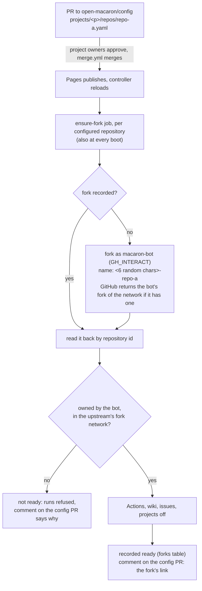

# macaron-bot — organisation, repositories and accounts

The org [`open-macaron`](https://github.com/open-macaron) owns all of our repositories. The user `macaron-bot` owns **only forks** of upstream repos, plus its profile repository `macaron-bot/macaron-bot`. It is the identity that opens PRs and comments.

## 1. Map

```
 github.com/open-macaron  (org, everything public)
┌───────────────────────────────────────────────────────────────────────────────────────────┐
│ macaron      controller + contracts + agent-cli + review + CLIs + deploy + docs           │──release──▶ ghcr.io/open-macaron/controller
│              CI, release.yml (changesets: image, CLIs, attestations)                      │             CLI bundles (GitHub releases)
│ config       trust config; project owners approve, merge.yml merges; Pages snapshot       │──Pages──▶ controller (CONFIG_URL); ◀─ onboarding comments (GH_ORG)
│ runner       run.yml + environments/ — where agents execute                               │◀─ start / cancel runs (GH_ORG), artifacts (GH_INTERACT)
│ knowledge    rules + lessons; folder owners approve, merge.yml merges; Pages read API     │◀─ PR from macaron-bot/knowledge (GH_ORG)
│ .github      LICENSE and README (org profile and community health files to add)           │
└───────────────────────────────────────────────────────────────────────────────────────────┘
          runner repository webhook (workflow_run) ─────────────────────▶ controller /v1/webhook
          config repository webhook (deployment_status) ────────────────▶ controller /v1/webhook

 github.com/macaron-bot  (user, owns forks only)
┌──────────────────────────────────────────────┐   PR + replies (GH_INTERACT)   ┌─────────────────────────┐
│ <upstream-1> … <upstream-30>  (Actions off)  │──────────────────────────────▶│ upstream repos (org-x…)  │
│ knowledge                     (Actions off)  │──▶ open-macaron/knowledge     └─────────────────────────┘
└──────────────────────────────────────────────┘
          ▲ push (GH_PUSH: fine-grained, owner macaron-bot, all its repos = forks only)
```

## 2. Repositories

| Repo | Contents | Who writes | Why separate |
|---|---|---|---|
| `open-macaron/macaron` (this repo) | `packages/controller`, `packages/{contracts,agent-cli,review,owners,knowledge-cli,config-cli}`, `deploy/`, `docs/` | Humans via PR | Source of truth for code. Releases through changesets; the controller rolls out from its ImageStream |
| `open-macaron/config` | `global.yaml`, `projects/<p>/project.yaml`, `projects/<p>/repos/<r>.yaml`, each project folder with `OWNERS.yaml` | Humans via PR, from forks. Project owners approve (no write access needed); `merge.yml` merges; the platform team merges `global.yaml` and reserved settings (users, budgets, runners) by hand | Trust config changes on its own cadence and goes live without a deploy: Pages publishes a snapshot the controller reloads on the deployment's webhook (DEPLOYMENT.md §6) |
| `open-macaron/runner` | `.github/workflows/run.yml` (the only workflow), `environments/` (shared: `generic`, `podman-desktop`, `podman-desktop-extensions`; own environments would go in `repos/<o>/<r>/`), plus a `README` describing the contract (SCALING.md §1) | Humans via PR; the bot only *dispatches* | Gives agent runs their own `repository_id` (the OIDC check pins it) and their own public run history. The token that dispatches runs can't trigger `macaron`'s `release.yml` |
| `open-macaron/knowledge` | `global/`, `projects/<p>/`, `repos/<owner>/<repo>/`, each with `OWNERS.yaml`, `rules/`, `lessons/` (DESIGN.md §6) | Humans write rules; the bot proposes lessons from its fork. Folder owners approve (no write access needed); `merge.yml` merges | High-churn, bot-authored content stays out of the code repo. Knowledge is versioned independently of controller releases |
| `open-macaron/.github` | `LICENSE` and `README.md` today; the org profile and default community health files (SECURITY.md, CONTRIBUTING.md) belong here | Humans | GitHub convention |
| `macaron-bot/<prefix>-<upstream>` | Forks named with a random 6-character prefix (`sf465s-podman-desktop`), so two upstreams with the same name never collide; branches `macaron/<n>-<slug>` | The controller only (GH_PUSH) | User-owned forks keep **"Allow edits by maintainers"**, which org-owned forks don't support. They also make "all repos of macaron-bot" mean exactly "the forks" |


How `run.yml` gets the agent-cli:
- It downloads `macaron-agent.mjs` from the `@open-macaron/agent-cli@<version>` release of `macaron`, pinned by **URL + sha256**.
- A maintainer bumps the pin in a PR to `runner`, after `gh attestation verify` against `macaron`'s `release.yml` (runner README). Renovate isn't set up.
- The agent job needs only `id-token: write`, and `contents: read` to check out the runner's environments.

## 3. Accounts and tokens

| Identity | Org role | Repo access |
|---|---|---|
| Humans | Org owners (2 people minimum; today one, `axel7083`). No teams yet | `admin` on all org repos |
| `macaron-bot` | Member | `write` on `runner` only, needed for `workflow_dispatch`. Read elsewhere (public). `runner` has no ruleset yet to stop it from creating or updating refs there (to do, §4) |

| Token (in the controller's Secret) | Type and owner | Permissions | Used for |
|---|---|---|---|
| `GH_INTERACT` | classic PAT of macaron-bot | `public_repo`, `notifications` | Comments, reactions, PRs and notifications on **upstream** repos. The org blocks classic PATs, so this token can't touch `open-macaron/*` |
| `GH_PUSH` | fine-grained, owner `macaron-bot`, all repositories | Contents: write. Workflows: write | `git push` to forks (macaron-bot owns nothing else but its profile repository), including `macaron-bot/knowledge`, and media uploads (user-attachments) against the fork (`EvidenceHost`). Workflows only carries upstream's own workflow commits when a fork is synced or branched; the controller never writes `.github/` itself. No Administration permission. **Never enable Actions on a fork**: onboarding disables them explicitly (§5) |
| `GH_ORG` | fine-grained, owner `open-macaron`, repositories `runner`, `knowledge` and `config`, approved by an org owner | `runner`: Actions read and write. `knowledge` and `config`: Pull requests read and write | Start and cancel runs; open and update the `remember:` proposals from `macaron-bot/knowledge`; comment on the `config` pull request that onboarded a repository (§5). The org blocks the classic `GH_INTERACT`. Artifacts use `GH_INTERACT` (public reads). A GitHub App could replace this token later, to avoid manual renewal |

The controller forks and secures with `GH_INTERACT` at onboarding (§5): the bot owns its forks, so it can configure them. It switches Actions off explicitly rather than rely on GitHub's default for forks.

## 4. Org settings

Verified on 2026-10-22:
- **Base permission:** `read`. Members: `axel7083` (owner) and `macaron-bot`.
- **Rulesets (per repository; there is no org-level ruleset):**
  - `macaron`: default branch through PRs only, the `check` and `image` jobs required, no force-push or deletion, no bypass. No approval count: one maintainer can't approve their own PRs, and the Version Packages PR merges itself.
  - `config` and `knowledge`: default branch through squash PRs only, approvals dismissed on a new push, no force-push or deletion, no bypass; branch creation blocked except for admins, so contributions come from forks. Approvals come from `OWNERS.yaml`, through `merge.yml`.
- **Webhooks:** repository webhooks only, both to `https://<controller-host>/v1/webhook` with the HMAC secret: `runner` (event `workflow_run`) and `config` (event `deployment_status`, its Pages deployments). Narrower than an org webhook.
- **Packages:** `ghcr.io/open-macaron/controller` is public and linked to `macaron`. Only `release.yml` publishes.

Intended, not in place yet (or not verifiable without `admin:org`), tracked in #46:
- 2FA required (off today); members can't create repos (allowed today).
- Classic PATs blocked for org resources; fine-grained PATs allowed with owner approval, 90 days at most (`GH_ORG` was approved this way).
- Actions: only GitHub-owned and allow-listed actions, pinned to full SHA; `GITHUB_TOKEN` read-only by default; Actions can't create or approve PRs; fork PR workflows from outside collaborators need approval.
- A `runner` ruleset: no ref creation or update except by maintainers. A tag ruleset: `@open-macaron/*@*` tags created only by `release.yml`.
- Secret scanning with push protection, Dependabot alerts and private vulnerability reporting on every repository (secret scanning is off on all four today).

The `macaron-bot` account itself: 2FA on; the profile says it's a bot and links here; **auto-watch off**, so forks and org repos don't flood the notifications the poller reads; e-mail notifications off; SSH signing key registered for verified commits.

## 5. Onboarding an upstream repo

A maintainer checks the upstream first:
- it is public (DESIGN.md "Everything is public");
- its contribution rules: DCO, a CLA to sign once for macaron-bot, interaction limits.

Then onboarding is one pull request to open-macaron/config, `projects/<p>/repos/<name>.yaml` with the upstream's `repo:` and no fork. The controller owns the forks: a configuration can't name one, so it can't point a repository at another of the bot's repositories.



- **Until the fork is ready**, the bot refuses requests on the repository ("still being onboarded"). GitHub creates a fork asynchronously; the job retries for about an hour.
- **The comment** goes on the merged pull request of the last commit touching the repository's file, if it merged in the last day, once. It is written with `GH_ORG` (§3).
- **A repository that leaves the configuration keeps its fork.** Nothing deletes one.
- **Fork networks:** GitHub allows one fork per network, so upstreams of one network (an upstream and a test fork of it) share the bot's fork.
- **Optional:** a PR to knowledge, `repos/org-x/repo-a/overview.md`.

A `fork:` key left in a repository file is accepted and ignored; open-macaron/config drops them.

## 6. Bootstrap checklist

1. Org: apply §4 settings.
2. Create `macaron` and push these docs. Then create `runner`, `config`, `knowledge` and `.github`. Apply the rulesets.
3. Create the three tokens (§3), approve `GH_ORG` in the org, and store them in the controller's Secret with `provision-secrets.sh` (DEPLOYMENT.md §4).
4. Add the webhooks once the controller has its public URL, both with the HMAC secret: `open-macaron/runner` (event `workflow_run`; done 2026-10-15, moved to the OpenShift Route on 2026-10-21) and `open-macaron/config` (event `deployment_status`; done 2026-10-22). See DEPLOYMENT.md §6, "Moving `PUBLIC_URL`".
5. Onboard one sandbox upstream repo (§5) for milestone 1.

> **No `evidence` repository** (decided 2026-10-16): run media are GitHub user-attachments, uploaded by the controller against the bot's fork of each repository (DESIGN.md, Evidence).
