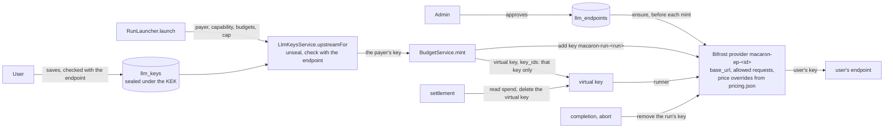

# Users' own LLM keys

Every run is billed to the key of whoever asked for it, on an endpoint an administrator approved, under a monthly cap the user sets (epic #51). This document is the design #58–#61 implement, and what the spike (#57) verified it on.

## 1. What Bifrost does (verified, #57)

Against `deploy/bifrost/dev.sh up` (Bifrost v2.3.0, the pinned image, configured like production), with the company gateway and a real key standing in for a user's:

| Question | Answer |
|---|---|
| A provider at runtime, base type `anthropic`, a custom `base_url`, one key? | Yes: `POST /api/providers` (`custom_provider_config.base_provider_type: anthropic`), then `POST /api/providers/{p}/keys`. Key values come back masked (first and last 4 characters). |
| Does it answer Claude Code's calls? | Yes, once `allowed_requests` has `responses`, `responses_stream`, `count_tokens` and `list_models` (Bifrost maps Anthropic Messages to `responses`): messages, streaming, token counting and the model list all work through the edge. |
| Routing | A virtual key whose `provider_configs` hold only that provider routes unprefixed model names (`claude-haiku-4-5`) to it: Claude Code needs no change. |
| Pricing | A runtime provider's models are **unpriced** (`/api/models/details` has no costs: charged $0, so a budget can't limit them). A `provider`-scoped **pricing override** per model fixes it; `/api/models/details` then reports the prices under `overridden_pricing`. Charges were exact (2 calls × (10 in × $1/M + 4 out × $5/M) = $0.00006). |
| One user's run using another's key? | Not when the virtual key's `key_ids` names the run's key: with a valid and an invalid key on the same provider, the key bound to the invalid one failed every call (401), the other succeeded every call. **Never `key_ids: ["*"]` on a shared provider.** |
| A key deleted mid-run | Its virtual key's next call fails (`no_key_supports_model`): settlement cuts access at once. |
| A Bifrost restart (`source_of_truth: config.json`) | **Runtime providers and their keys are gone**; pricing overrides and virtual keys stay, but virtual keys lose their bindings to the providers. |
| Keys at rest | Encrypted (`BIFROST_ENCRYPTION_KEY`): a 128-character ciphertext in `config_keys`; the key appears in no table, in no `pg_dump`, and not in Bifrost's logs. |
| A private base URL | Refused by Bifrost itself (400, "private IP addresses are not allowed"), on top of our own check and the egress NetworkPolicy. |

## 2. How it works

- **One Bifrost provider per approved endpoint** (`macaron-ep-<endpoint id>`, base type anthropic, the four request types Claude Code sends, 16 requests in flight). The controller ensures it before every mint (`BifrostKeys`), since a Bifrost restart drops providers created at runtime.
- **Prices are provider-scoped overrides,** one per configured model, created or brought back to the pinned price. With no provider configured Bifrost lists no catalog price at all, so the controller reads `deploy/bifrost/pricing.json` itself (`LLM_PRICING_FILE`, mounted from Bifrost's ConfigMap), every field Bifrost's price patch accepts.
- **The user's key is in Bifrost for one run only:** added to the endpoint's provider under the run key's name (`macaron-run-<run id>`) when the run is minted, and the run's virtual key may use that key alone (`key_ids`). It is removed as soon as the run stops spending (completion or abort); settlement still reads the spend from the virtual key, then deletes it. Housekeeping sweeps any user key no unsettled run names.
- **A Bifrost restart breaks in-flight runs** (their keys and bindings are gone). `deploy.sh` refuses to restart Bifrost while a run is unsettled; an eviction mid-run fails that run, and its user retries.
- **Prices are list prices.** An endpoint may bill differently (the company gateway does): the web app says "estimated", and each endpoint carries a pricing note.
- **No shared key:** Bifrost's configuration has no provider and no LLM key. `LLM_BACKEND=openrouter` refuses runs: OpenRouter can't bill a user's key.

## 3. Storing users' keys (#59)

- AES-256-GCM (`node:crypto`, 12-byte IV, 16-byte tag, both enforced), sealed under a key-encryption key (KEK) in its own Secret, `macaron-llm-kek`, mounted read-only as files (`v1`, `v2`…, mode 0440) in the controller only. Never an environment variable, never in Postgres, `pg_dump` or the repository. The cluster has no Vault, External Secrets or KMS: its namespace admins can read Secrets. The key page says so.
- AAD = user id + endpoint id: a ciphertext can't be moved to another user or endpoint. Each row has its `kek_version`. Rotation: `LLM_KEK_ROTATE=1 provision-secrets.sh`, a controller restart, `node dist/rotate-llm-keys.js` in the pod, then `LLM_KEK_RETIRE=<n>` (docs/DEPLOYMENT.md §4).
- Unsealed in two places only: `LlmKeysService.upstreamFor`, which hands the key to Bifrost for one run, and the rotation.
- Write-only: the API returns the endpoint, the last 4 characters and the validation date. Saving needs a sign-in younger than 10 minutes (the session's creation, which renewals don't move), allows 5 attempts per user and hour and one at a time, and checks the key with its endpoint (`GET /v1/models`, `x-api-key`, no redirect, through a lookup that refuses non-public addresses at connect time). No database connection is held during that check. The form field is `_key`: remote forms never send it back.
- Before each run the key is checked again: one the endpoint now refuses is marked `rejected` and the run is refused.
- Append-only `llm_key_events` (triggers refuse update, delete and truncate, except with the user): created, replaced, deleted, used by a run (with its thread), rejected by the endpoint, unreachable.

## 4. Who pays (#60) and how much (#61)

- The run is billed to the account it runs for (#71), recorded on `runs.payer_id`: whoever asked, or for escalations, retries and review bots' comments, whoever asked first. Without a usable key (none saved, rejected, endpoint disabled, unreadable, endpoint unreachable) the run is refused with a reply that says why and links to the key page.
- A monthly cap per user (calendar month, UTC), optional: a run is refused when what the month was billed to the user, plus the limits of their runs in progress, plus its own limit would pass the cap. The refusal says what's left. Project and repository budgets apply as well.
