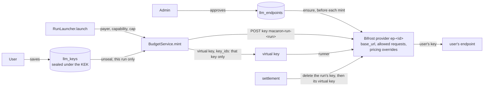

# Users' own LLM keys

Every run is billed to the key of whoever asked for it, on an endpoint an administrator approved, under a monthly cap the user sets (epic #51). This document is the design #58–#61 implement, and what the spike (#57) verified it on.

## 1. What Bifrost does (verified, #57)

Against `deploy/bifrost/dev.sh up` (Bifrost v2.3.0, the pinned image, configured like production), with the company gateway and a real key standing in for a user's:

| Question | Answer |
|---|---|
| A provider at runtime, base type `anthropic`, a custom `base_url`, one key? | Yes: `POST /api/providers` (`custom_provider_config.base_provider_type: anthropic`), then `POST /api/providers/{p}/keys`. Key values come back masked (first and last 4 characters). |
| Does it answer Claude Code's calls? | Yes, once `allowed_requests` has `responses`, `responses_stream`, `count_tokens` and `list_models` (Bifrost maps Anthropic Messages to `responses`): messages, streaming, token counting and the model list all work through the edge. |
| Routing | A virtual key whose `provider_configs` hold only that provider routes unprefixed model names (`claude-haiku-4-5`) to it: Claude Code needs no change. |
| Pricing | A runtime provider's models are **unpriced** (`/api/models/details` has no costs: charged $0, so a budget can't limit them). A `provider`-scoped **pricing override** per model fixes it; `/api/models/details` then reports the prices under `overridden_pricing`. Charges were exact (2 calls × (10 in × $1/M + 4 out × $5/M) = $0.00006). |
| One user's run using another's key? | Not when the virtual key's `key_ids` names the run's key: with a valid and an invalid key on the same provider, the key bound to the invalid one failed every call (401), the other succeeded every call. **Never `key_ids: ["*"]` on a shared provider.** |
| A key deleted mid-run | Its virtual key's next call fails (`no_key_supports_model`): settlement cuts access at once. |
| A Bifrost restart (`source_of_truth: config.json`) | **Runtime providers and their keys are gone**; pricing overrides and virtual keys stay, but virtual keys lose their bindings to the providers. |
| Keys at rest | Encrypted (`BIFROST_ENCRYPTION_KEY`): a 128-character ciphertext in `config_keys`; the key appears in no table, in no `pg_dump`, and not in Bifrost's logs. |
| A private base URL | Refused by Bifrost itself (400, "private IP addresses are not allowed"), on top of our own check and the egress NetworkPolicy. |

## 2. Design

- **One Bifrost provider per approved endpoint** (`ep-<endpoint id>`), with the four allowed request types and one pricing override per configured model, copied from the pinned list prices (`deploy/bifrost/pricing.json`, every field `PricingPatch` accepts). The controller ensures it (create when missing, idempotent) before every mint: a Bifrost restart drops it.
- **The user's key lives in Bifrost for one run only**: added to the endpoint's provider as `macaron-run-<run id>` when the run's virtual key is minted, bound by `key_ids` to that key alone, deleted at settlement, on abort, and by Housekeeping's sweep.
- **A Bifrost restart breaks in-flight runs** (their keys and bindings are gone). `deploy.sh` already refuses to restart Bifrost while a run is unsettled; an eviction mid-run fails that run, and its user retries.
- **Prices are list prices.** An endpoint may bill differently (the company gateway does): the web app says "estimated cost", and each endpoint carries a pricing note.
- **No shared key**: the `anthropic` provider and `LLM_UPSTREAM_KEY` leave Bifrost's configuration once every run is billed to a user (#60).

## 3. Storing users' keys (#59)

- AES-256-GCM (`node:crypto`), sealed under a key-encryption key (KEK) in its own Secret, `macaron-llm-kek`, mounted as a **file** in the controller only. Never an environment variable, never in Postgres, `pg_dump` or the repository. The cluster has no Vault, External Secrets or KMS: its namespace admins can read Secrets. The key form says so.
- AAD = user id + endpoint id: a ciphertext can't be moved to another user or endpoint. Each row has its `kek_version`; `macaron-controller keys rotate` re-seals every row under the newest version.
- Decrypted in one place (`LlmKeysService.unsealFor`), handed straight to Bifrost for one run.
- Write-only: the API returns the endpoint, the last 4 characters and the validation date. Saving needs a session younger than 10 minutes, is rate limited, and probes the endpoint (`GET /v1/models`, no redirects) for the configured models. The form field is `_key`: remote forms never send it back.
- Append-only `llm_key_events`: created, replaced, deleted, used by a run, rejected by the endpoint.

## 4. Who pays (#60) and how much (#61)

- The run is billed to the account it runs for (#71): whoever asked, or for escalations, retries and review bots' comments, whoever asked first. Without a usable key (none saved, rejected, endpoint disabled), the run is refused with a reply that says why and links to the web app.
- A monthly cap per user: refused when this month's spend plus the run's limit would pass it; otherwise the run's limit is the smaller of the mode's budget and what is left.
